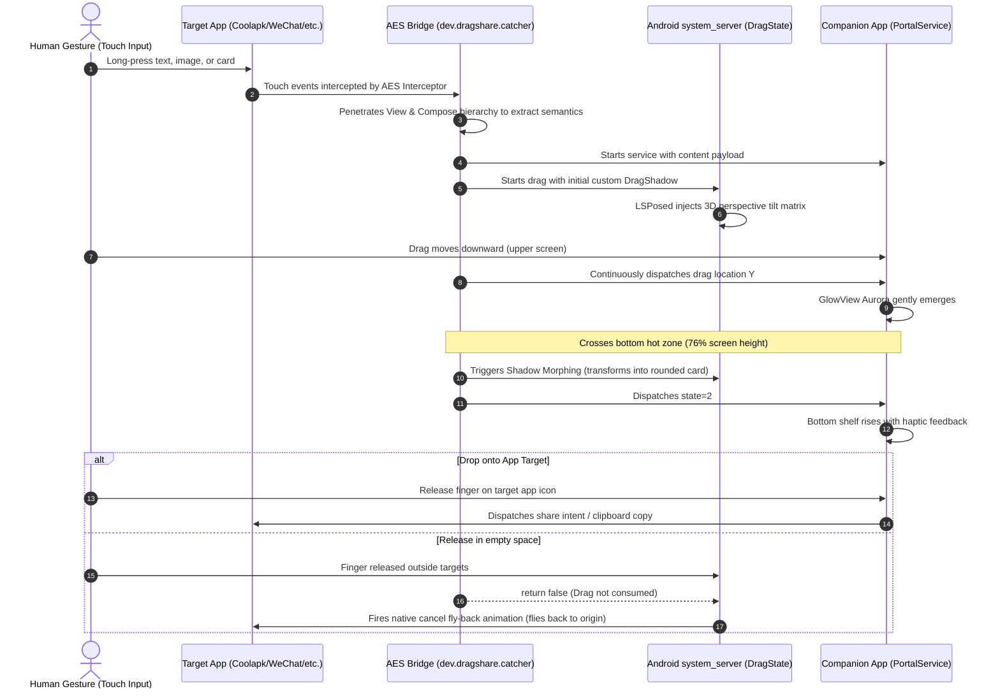

# ohmyAES (DragShare)

> Bringing ColorOS 15 Fluid Cloud / DragShare content portal interactive experience and fluid animations to Xiaomi HyperOS!  
> Features system-level multimodal content extraction, ColorOS Aurora Glow AGSL shader, bottom rearrangement & shadow morphing, and LSPosed `system_server` 3D tilt transformation.

[English](README.md) | [简体中文](README_CN.md) | [AI Agent & Contributor Guide (AGENTS.md)](AGENTS.md)

---

## 🌟 Feature Matrix

| Module | Technology | Highlights |
| :--- | :--- | :--- |
| 🎯 **Multimodal Content Extraction** | Privileged AES Plugin + Hybrid View Traversal | Deep penetration into classic View hierarchies, Jetpack Compose Semantics, and `AndroidViewsHandler` hybrid trees (seamlessly extracts Coolapk feed posts, WeChat, Weibo, Xiaohongshu, Telegram, etc.). |
| 🌈 **ColorOS Aurora Glow** | AGSL (Android Graphics Shading Language) | Custom hardware-accelerated `RuntimeShader` with multi-frequency noise displacement. Progressively ramps with finger movement. |
| 📱 **Rearrangement & Card Morphing** | Dynamic WMS Drag Shadow Morphing | Morphs into a rounded-corner card and slightly scales down upon crossing the 76% bottom threshold, smoothly raising the app shelf with haptics. |
| ↩️ **Native Cancel Fly-Back** | WMS Return Trajectory Restoration | Strictly returns `false` on non-target drops, seamlessly triggering Android's native WindowManager cancel fly-back animation to the original text/image position. |
| 📐 **3D Spatial Tilt Transformation** | LSPosed `system_server` Hook | Directly hooks `com.android.server.wm.DragState`, manipulating the SurfaceFlinger layer via `SurfaceControl.Transaction.setMatrix` to create real-time 3D perspective tilt. |

---

## 🏗️ Interactive Lifecycle



---

## 📁 Repository Structure

```
ohmyAES/
├── aes/                               # [Component 1] Privileged System Hook Component
│   ├── src/                           # Java source injected into AES classes2.dex
│   │   └── dev/dragshare/catcher/
│   │       └── Bridge.java            # Content extraction, touch hooks, gesture bridge
│   ├── smali_project/                 # Host Smali project for building classes.dex
│   ├── base/                          # Official base APK (Application Extension Service_5.1.7.apk)
│   └── patches/                       # Automated Smali injector script
│
├── bridge/                            # [Component 2] Companion App & LSPosed Module
│   ├── AndroidManifest.xml
│   ├── src/
│   │   └── com/dragshare/portal/
│   │       ├── MainActivity.java      # Settings & overlay permission entry
│   │       ├── PortalService.java     # Aurora GlowView, bottom shelf, drop interception
│   │       ├── PortalReceiver.java    # IPC broadcast synchronization
│   │       ├── PortalFileProvider.java# FileProvider for secure cross-app sharing
│   │       └── system/
│   │           └── PortalSystemModule.java # LSPosed module (system_server 3D tilt)
│   ├── assets/
│   │   └── oppo_glow.png              # Aurora noise texture
│   ├── resources/
│   │   └── META-INF/xposed/           # Modern LSPosed module descriptors
│   └── libs/                          # Compile-time Xposed API & Stubs
│
├── tools/                             # Unified Build & Deployment Toolchain
│   ├── config.py                      # Android SDK, Build-Tools, Apktool auto-detection
│   ├── build.py                       # High-speed dual-target builder
│   ├── deploy.py                      # One-click install, LSPosed sync, soft reboot, logcat
│   └── repack.py                      # Binary AXML versionCode modifier & DEX bundler
│
├── docs/                              # Reverse engineering and architecture documentation
│   ├── ARCHITECTURE.md
│   ├── COLOROS_VIEWDRAG_SPEC.md
│   └── COLOROS_COMPOSE_EXTRACTION_SPEC.md
│
├── signing/                           # Signing keystore (poc.jks)
├── dist/                              # Output directory for release APKs
├── AGENTS.md                          # ⚠️ Mandatory Engineering Rules for AI Agents & Developers
├── README.md                          # English documentation
└── README_CN.md                       # Chinese documentation
```

---

## 🚀 Building from Source

No Gradle or manual patch scripts needed. Directly invokes Android SDK build tools:

### 1. Prerequisites
- **Python 3.8+**
- **JDK 11+**
- **Android SDK** (with `ANDROID_HOME` set, including `build-tools` 33+ and `platforms`)

### 2. Build Commands

```bash
# Build both APKs (DragShareBridge.apk + ContentCatcher-patched.apk)
python tools/build.py all

# Build DragShareBridge only
python tools/build.py bridge

# Build AES patched APK only
python tools/build.py aes

# Clean build cache
python tools/build.py clean
```

Artifacts are placed in `dist/`:
- `dist/DragShareBridge.apk`
- `dist/ContentCatcher-patched.apk`

---

## 📲 Deployment & Debugging

```bash
# 1. Install both APKs and sync LSPosed scope
python tools/deploy.py --install all --refresh-lsp

# 2. Soft reboot (restart system_server, takes ~5s)
python tools/deploy.py --soft-reboot

# 3. Attach live logcat monitor
python tools/deploy.py --logs
```

---

## ❓ Frequently Asked Questions (FAQ)

<details>
<summary><b>Q1: Why did the 3D tilt animation disappear after a hard reboot? Do I need a soft reboot every time?</b></summary>

**A:** **No! Daily reboots never require a soft reboot.**  
The issue occurred during development because `adb install -r` generated a new hash directory for the APK in `/data/app/`. An immediate hard reboot caught LSPosed with an unsynced cache, attempting to load the deleted old path at early boot. Once persisted, the APK path remains fixed forever across all hard reboots and normal boots. A soft reboot is only required when you compile and install new hook code via ADB from your computer.
</details>

<details>
<summary><b>Q2: Why does the drag shadow sometimes vanish instead of flying back to the original text?</b></summary>

**A:** In Android's WindowManager, the return animation (`createCancelAnimationLocked`) is only executed if `ACTION_DROP` returns `false`. If any listener erroneously returns `true`, WMS treats the drop as consumed and immediately dismisses the shadow. ohmyAES strictly returns `false` on drops outside valid targets.
</details>

<details>
<summary><b>Q3: Why were Coolapk feed posts previously unrecognized?</b></summary>

**A:** Coolapk overlays a transparent `CanvasProxyView` (Slidr swipe-to-back proxy) and nests its feed inside `ComposeView` $\rightarrow$ `AndroidViewsHandler` $\rightarrow$ `ViewFactoryHolder`. Standard Compose semantics only reveal empty wrappers. ohmyAES uses deep hybrid penetration to bypass proxy views and extract the true `FixAppCompatTextView` and images.
</details>

---

## 🤖 Guidelines for AI Agents & Contributors

Before submitting PRs or prompting AI agents, **please read [AGENTS.md](AGENTS.md)**:
- **Never automate touch events on physical test devices** (leave gestures to human testers; agents only monitor logs).
- **Never use full-screen fallback screenshots** (maintain 100% semantic extraction).
- **Respect the 76% / 70% hysteresis thresholds** and **AGSL shader modulo wrapping**.

---

## 📄 License

Licensed under the [GNU General Public License v3.0 (GPL-3.0)](LICENSE).
