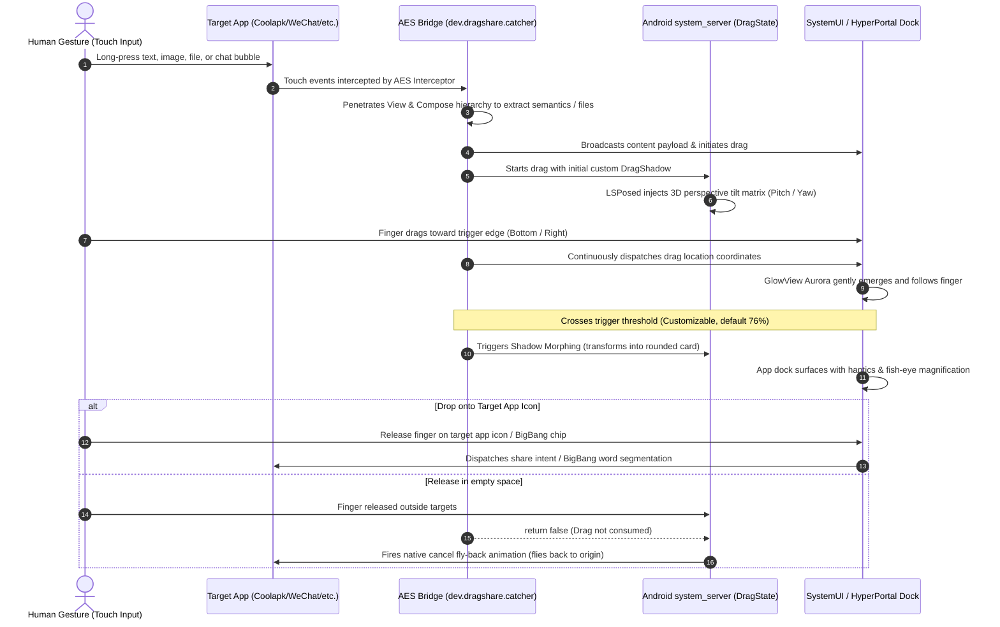

# HyperPortal (ohmyAES)

> Bringing the fluid, multimodal **ColorOS 15 Fluid Cloud / Content Portal (DragShare)** experience to **Xiaomi HyperOS (Android 14/15)**!  
> Powered by system-level multimodal content extraction, ColorOS Aurora Glow AGSL shader, bottom & right-edge dynamic docks, BigBang text segmentation, and LSPosed `system_server` 3D perspective spatial tilt.

[English](README.md) | [简体中文](README_CN.md) | [AI Agent & Contributor Guide (AGENTS.md)](AGENTS.md)

---

## 🌟 Feature Highlights

| Module | Technology | Highlights |
| :--- | :--- | :--- |
| 🎯 **Multimodal Content Extraction** | Privileged AES Plugin + Hybrid Tree Traversal | Deep penetration into classic View hierarchies, Jetpack Compose Semantics, and `AndroidViewsHandler` hybrid trees (Coolapk feed & image viewers, Bilibili Compose viewer, Weibo, Xiaohongshu, Telegram, etc.). |
| 💬 **WeChat Chat & File Extraction** | Chat Bubble & File Resolution Engine | Resolves WeChat chat bubbles and physical file attachments (`.ref` UUID pointers, shared app storage cache, XML entity unescaping). Built-in LRU cache pruner (max 5 files, 12h TTL). |
| 🗂️ **Dual Dock Trigger Modes** | Bottom Shelf & Right Edge Vertical Dock | Choose between classic **Bottom Shelf** and **Right Edge Dock**. Features full-height gesture coverage, status bar cutout avoidance, smooth fish-eye icon magnification following finger Y coordinates, and high-FPS edge glow tracking. |
| 🌈 **ColorOS Aurora Glow** | AGSL (Android Graphics Shading Language) | Custom hardware-accelerated `RuntimeShader` with multi-frequency noise displacement and 60s modulo time wrapping to prevent GPU precision loss. Gently scales with finger motion. |
| 📱 **Dynamic Rearrangement & Morphing** | WMS Drag Shadow Morphing | Morphs into a rounded-corner card and scales down upon crossing the customizable threshold (default 76%), raising the app dock with haptics. |
| 📐 **3D Spatial Tilt Transformation** | LSPosed `system_server` Hook | Directly hooks `com.android.server.wm.DragState`, manipulating the SurfaceFlinger layer via `SurfaceControl.Transaction.setMatrix` to create real-time 3D pitch and yaw perspective tilt adapted to dock position. |
| ✂️ **BigBang Text Segmentation** | cppjieba (C++ JNI) + Jetpack Compose | Drop text into the dock to trigger local word segmentation: word chips support multi-select, slide-select, copy, dictionary/web search, system sharing, and character splitting without data ever leaving the device. |
| ↩️ **Native Cancel Fly-Back** | WMS Return Trajectory Restoration | Strictly returns `false` on non-target drops, triggering Android's native WindowManager cancel fly-back physics animation back to the origin position. |
| ⚙️ **Modern Miuix Compose UI** | Miuix Compose + Adaptive Icon | Native HyperOS visual style settings page built with Miuix UI & Preference components, customizable trigger position, threshold sliders, and adaptive launcher icons. |

---

## 🏗️ Interactive Lifecycle



---

## 📁 Repository Structure

```
HyperPortal/
├── aes/                               # [Component 1] Privileged System Hook (AES)
│   ├── src/                           # Java source injected into AES classes2.dex
│   │   └── dev/dragshare/catcher/
│   │       └── Bridge.java            # Content extraction, touch hooks, gesture bridge
│   ├── smali_project/                 # Host Smali project for building classes.dex
│   ├── base/                          # Official base APK (Application Extension Service_5.1.7.apk)
│   └── patches/                       # Automated Smali injector script
│
├── bridge/                            # [Component 2] HyperPortal App & LSPosed System Modules
│   ├── AndroidManifest.xml
│   ├── build.gradle.kts               # Gradle build script (Miuix, NDK, Cmake, R8 rules)
│   ├── proguard-rules.pro             # ProGuard / R8 keep rules
│   ├── src/main/
│   │   ├── cpp/                       # C++ JNI TextSegmenter (cppjieba)
│   │   ├── java/com/dragshare/portal/ # Companion Service, SystemServer tilt hook, SystemUI dock
│   │   │   ├── system/PortalSystemModule.java    # LSPosed hook for system_server 3D tilt
│   │   │   ├── system/PortalSystemUiModule.java  # LSPosed hook for SystemUI dock & glow
│   │   │   └── ui/                               # Miuix Compose settings & BigBang UI
│   │   ├── assets/                    # Aurora noise texture & cppjieba dictionaries
│   │   └── res/                       # Vectors, Miuix styles, and adaptive launcher icons
│   └── resources/META-INF/xposed/     # Modern LSPosed module descriptors
│
├── tools/                             # Unified Build & Deployment Toolchain
│   ├── config.py                      # Android SDK, Build-Tools, signing auto-detection
│   ├── build.py                       # High-speed dual-target builder (supports --r8)
│   ├── deploy.py                      # One-click install, LSPosed sync, soft reboot, logcat
│   └── repack.py                      # Binary AXML versionCode modifier & DEX bundler
│
├── design/icons/                      # Adaptive launcher icon SVG designs & preview gallery
├── docs/                              # Reverse engineering and architecture documentation
├── .sign/                             # Local signing keystore/credentials (git-ignored)
├── dist/                              # Output directory for release APKs (git-ignored)
└── AGENTS.md                          # ⚠️ Mandatory Engineering Rules for AI Agents & Developers
```

---

## 🚀 Building from Source

### 1. Prerequisites
- **Python 3.8+**
- **JDK 17+**
- **Android SDK** (API 34/37, `build-tools` 34+, Android NDK `26.1.10909125`, CMake `3.22.1`)
- **Signing Credentials**: Place `my-release-key.jks` and `qianming.txt` into `.sign/` (see [Signing Boundary](AGENTS.md#rule-9-release-signing--r8-boundary)).

### 2. Build Commands

```bash
# Build both APKs with R8 optimization enabled for HyperPortal
python tools/build.py all --r8

# Build HyperPortal only (Normal test build, R8 off)
python tools/build.py bridge

# Build HyperPortal with R8 minification (~6.9 MB)
python tools/build.py bridge --r8

# Build AES patched APK only (always unminified)
python tools/build.py aes

# Clean build cache
python tools/build.py clean
```

Artifacts are placed in `dist/`:
- `dist/HyperPortal-r8.apk` (or `dist/HyperPortal.apk`)
- `dist/ContentCatcher-patched.apk`

---

## 📲 Deployment & Debugging

```bash
# 1. Install both APKs and sync LSPosed scope
python tools/deploy.py --install all --refresh-lsp

# 2. Attach live logcat monitor (passively monitors physical device gestures)
python tools/deploy.py --logs

# 3. Soft reboot (only needed when testing new system_server hook changes)
python tools/deploy.py --soft-reboot
```

---

## ❓ Frequently Asked Questions (FAQ)

<details>
<summary><b>Q1: Why did the 3D tilt animation disappear after a hard reboot? Do I need a soft reboot every time?</b></summary>

**A:** **No! Daily reboots never require a soft reboot.**  
The issue only occurs during development because `adb install -r` generates a new randomized hash directory for the APK in `/data/app/`. An immediate hard reboot caught LSPosed with an unsynced cache attempting to load the old deleted path. Once persisted, the APK path remains fixed forever across all hard reboots and cold boots. A soft reboot is only needed when pushing new hook code during development.
</details>

<details>
<summary><b>Q2: Why does the drag shadow sometimes vanish instead of flying back to the source text/image?</b></summary>

**A:** In Android's WindowManager, the return animation (`createCancelAnimationLocked`) only executes if `ACTION_DROP` returns `false`. If any listener erroneously returns `true`, WMS treats the drag as consumed and dismisses the shadow immediately. HyperPortal strictly returns `false` on any drop outside valid targets.
</details>

<details>
<summary><b>Q3: How are Coolapk and hybrid Jetpack Compose layouts penetrated?</b></summary>

**A:** Coolapk overlays a transparent `CanvasProxyView` (Slidr swipe-to-back proxy) and nests its feed inside `ComposeView` $\rightarrow$ `AndroidViewsHandler` $\rightarrow$ `ViewFactoryHolder`. Standard Compose semantics only reveal empty wrappers. HyperPortal uses deep recursive hybrid penetration to bypass proxy views and extract the true `FixAppCompatTextView` and images directly.
</details>

<details>
<summary><b>Q4: How does WeChat chat file extraction work?</b></summary>

**A:** WeChat chat file items store `.ref` UUID pointers rather than direct file paths. HyperPortal parses chat bubble hierarchies, resolves the underlying physical files from the shared application cache, unescapes XML entities, and maintains an automatic LRU cache pruner (keeping up to 5 files with a 12-hour TTL).
</details>

---

## 🤖 Guidelines for AI Agents & Contributors

Before submitting PRs or prompting AI agents, **please read [AGENTS.md](AGENTS.md)**:
- **Never automate touch events on physical test devices** (leave gestures to human testers; agents only monitor logs).
- **Never use full-screen fallback screenshots** (maintain 100% semantic extraction).
- **Never auto-reboot or soft-reboot the device** without explicit user confirmation.
- **Respect the hysteresis thresholds** (76% enter, 70% exit) and **AGSL shader modulo wrapping**.
- **Commit code changes promptly to git** upon verification.

---

## 📄 License

Licensed under the [GNU General Public License v3.0 (GPL-3.0)](LICENSE).
