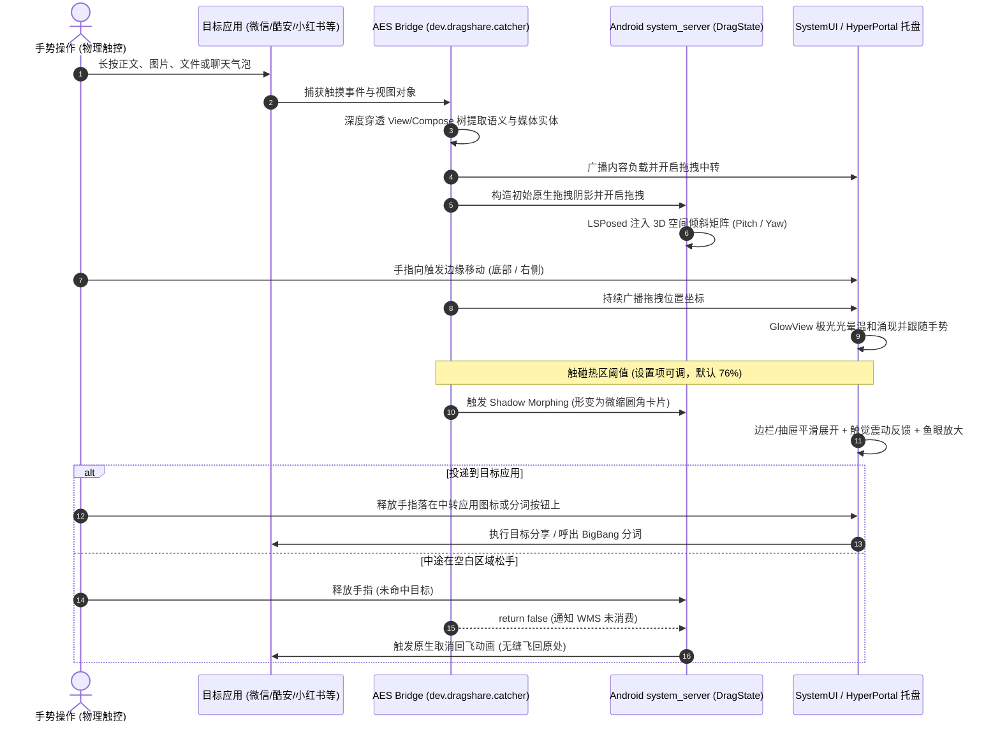

# HyperPortal (ohmyAES)

> 将 ColorOS 15 流体云 / 内容传送门（DragShare）完整的交互体验与多模态流体动效，无缝带到小米 HyperOS（Android 14/15）！  
> 包含系统级多模态内容识别、ColorOS 极光流光着色器、底部与右侧动态边栏、BigBang 大爆炸分词、以及基于 LSPosed 的底层 3D 空间倾斜动画。

[English](README.md) | [简体中文](README_CN.md) | [开发者与 AI 维护指南 (AGENTS.md)](AGENTS.md)

---

## 🌟 核心特性一览

| 模块 | 核心技术 | 功能说明 |
| :--- | :--- | :--- |
| 🎯 **多模态内容提取** | AES 特权挂载 + 混合 View 树穿透 | 深度穿透传统 View、Jetpack Compose 语义树、`AndroidViewsHandler` 混合布局（完美支持酷安动态正文与大图、B站 Compose 动态预览、微信、微博、小红书、Telegram 等）。 |
| 💬 **微信气泡与文件解析** | 原生解析引擎 + 本地 LRU 缓存 | 深度解析微信聊天气泡与附件，支持解析 `.ref` UUID 映射指针与共享缓存文件，自动反转义 XML 实体，内建 LRU 自动清理（最多缓存 5 份文件，12 小时生命周期）。 |
| 🗂️ **双触发方向边栏** | 底部应用抽屉 & 右侧垂直 Dock | 支持**底部托盘**与**右侧边栏**自由切换。右侧 Dock 支持全屏手势触发、避开顶部挖孔刘海、基于当前手指 Y 坐标的平滑鱼眼放大特效与高帧率极光边缘跟随。 |
| 🌈 **ColorOS 极光光效** | AGSL (Android Graphics Shading Language) | 采用自定义 `RuntimeShader` 实现 1:1 动态流动极光，多频噪波扰动，时间变量 60s 取模防止 GPU 浮点溢出，随手指位移实时平滑映射。 |
| 📱 **重排与变形动画** | WMS 动态阴影变形 (Shadow Morph) | 拖拽触碰设定阈值（默认 76%）时，系统拖拽浮层平滑形变为微缩圆角卡片，应用抽屉/边栏伴随震动升起。 |
| 📐 **3D 空间倾斜动画** | LSPosed `system_server` 挂载 | Hook 底层 `com.android.server.wm.DragState`，通过 `SurfaceControl.Transaction.setMatrix` 直接在 SurfaceFlinger 层面施加真实 3D 俯仰与偏航（Pitch & Yaw）空间倾斜投影，适配左右/底部方向。 |
| ✂️ **BigBang 文本分词** | cppjieba (C++ JNI) + Jetpack Compose | 文字拖拽进中转站即可呼出大爆炸分词：本地结巴分词拆成独立词块，支持点选/滑动连选、复制、网页/词典搜索、系统分享及单字细分，全文不离设备。 |
| ↩️ **原生取消回飞动画** | WMS Native Fly-back Restoration | 任意非目标区域松手时，完全还原 Android 底层 WindowManager 物理抛物线飞回原文字/原图位置。 |
| ⚙️ **Miuix 质感设置与自适应图标** | Miuix Compose + 自适应图标 | 遵循 HyperOS 原生视觉风格，采用 Miuix UI/Preference 库打造设置界面，支持调整触发方向、触发灵敏度滑块，并配备现代自适应启动器图标。 |

---

## 🏗️ 交互动效流程



---

## 📁 仓库代码结构

```
HyperPortal/
├── aes/                               # 【组件 1】AES 特权系统服务挂载注入端
│   ├── src/                           # 注入到 AES classes2.dex 的核心 Java 源码
│   │   └── dev/dragshare/catcher/
│   │       └── Bridge.java            # 内容深度穿透提取、触控分发、热区重排动画
│   ├── smali_project/                 # 宿主 Smali 项目（由 apktool 组装 classes.dex）
│   ├── base/                          # 官方基础包 (Application Extension Service_5.1.7.apk)
│   └── patches/                       # 自动化 Smali 补丁注入脚本
│
├── bridge/                            # 【组件 2】HyperPortal 伴侣应用 & LSPosed 系统模块
│   ├── AndroidManifest.xml
│   ├── build.gradle.kts               # Gradle 编译脚本 (Miuix, NDK, Cmake, R8 规则)
│   ├── proguard-rules.pro             # ProGuard / R8 混淆规则
│   ├── src/main/
│   │   ├── cpp/                       # C++ JNI TextSegmenter (cppjieba 分词引擎)
│   │   ├── java/com/dragshare/portal/ # 伴侣服务、system_server 倾斜、SystemUI 托盘
│   │   │   ├── system/PortalSystemModule.java    # Hook system_server 实现 3D 倾斜
│   │   │   ├── system/PortalSystemUiModule.java  # Hook SystemUI 实现常驻托盘与极光
│   │   │   └── ui/                               # Miuix Compose 设置界面与 BigBang 交互
│   │   ├── assets/                    # 极光噪波纹理与结巴词典
│   │   └── res/                       # 矢量资源、Miuix 主题及自适应应用图标
│   └── resources/META-INF/xposed/     # LSPosed 现代模块作用域与元数据
│
├── tools/                             # 统一构建、打包与设备部署基础设施
│   ├── config.py                      # Android SDK、Build-Tools、签名凭据自动探测
│   ├── build.py                       # 极速双目标构建器（支持 --r8 优化构建）
│   ├── deploy.py                      # 一键安装、LSP 路径刷新、软重启、日志监听
│   └── repack.py                      # 二进制 AXML versionCode 修改与 DEX 合并
│
├── design/icons/                      # 自适应启动器图标设计源文件及 HTML 画廊
├── docs/                              # 技术架构、逆向规范与交付文档
├── .sign/                             # 本地签名密钥与口令（已 git 忽略）
├── dist/                              # 最终产物输出目录（已加入 .gitignore）
└── AGENTS.md                          # ⚠️ AI Agent 与开发者必须遵守的核心工程守则
```

---

## 🚀 极速构建与开发

### 1. 环境依赖
- **Python 3.8+**
- **JDK 17+**
- **Android SDK**（API 34/37，`build-tools` 34+，Android NDK `26.1.10909125`，CMake `3.22.1`）
- **签名凭据**：在 `.sign/` 目录下放置 `my-release-key.jks` 与 `qianming.txt`（详情见 [AGENTS.md 签名边界规范](AGENTS.md#rule-9-release-signing--r8-boundary)）。

### 2. 统一构建命令

```bash
# 一键编译全部产物 (启用 R8 混淆优化 HyperPortal)
python tools/build.py all --r8

# 仅构建伴侣应用（常规开发调试，不启用 R8，秒级构建）
python tools/build.py bridge

# 仅构建伴侣应用（启用 R8 混淆优化，体积压缩至约 6.9MB）
python tools/build.py bridge --r8

# 仅构建 AES 特权注入包（始终保持非混淆）
python tools/build.py aes

# 清除所有中间构建缓存
python tools/build.py clean
```

输出文件将位于 `dist/`：
- `dist/HyperPortal-r8.apk`（或 `dist/HyperPortal.apk`）
- `dist/ContentCatcher-patched.apk`

---

## 📲 一键部署与调试

```bash
# 1. 一键安装双 APK 并刷新 LSPosed 模块作用域
python tools/deploy.py --install all --refresh-lsp

# 2. 启动实时日志监听（被动监听真实机手势测试）
python tools/deploy.py --logs

# 3. 快速软重启 (仅在修改了 system_server 倾斜模块代码后需要执行一次，耗时约 5 秒)
python tools/deploy.py --soft-reboot
```

---

## ❓ 常见问题解答 (FAQ)

<details>
<summary><b>Q1: 为什么硬重启之后倾斜动画会消失？需要每次都软重启吗？</b></summary>

**A:** **日常使用绝对不需要软重启！**  
之前消失是因为在开发调试阶段，刚刚用 ADB 覆盖安装了新包，Android 12+ 会给应用随机生成新哈希路径；此时立即硬重启，导致开机第一秒 LSPosed 读到了已被删除的前一次路径。  
一旦正常运行落盘，APK 物理路径永久固定，**无论冷开机、正常关机还是硬重启，倾斜动画均 100% 自动生效**。唯一需要软重启的时机是：你在电脑上修改了 Hook 代码并刚推了新包。
</details>

<details>
<summary><b>Q2: 为什么中途松手时，原版可以飞回文字原处，有时候会突然直接消失？</b></summary>

**A:** Android 底层 `WindowManagerService` 只有在 `DragEvent.ACTION_DROP` 返回 `false`（表示拖拽未被目标消费）时，才会播放 `createCancelAnimationLocked` 飞回动画。只要任何监听器返回了 `true`，系统就会认为拖拽成功从而瞬间隐藏阴影。本项目已在源码层面严格保证空放时返回 `false`，确保 100% 飞回。
</details>

<details>
<summary><b>Q3: 酷安长按动态及 Jetpack Compose 视图是如何识别穿透的？</b></summary>

**A:** 酷安在最顶层套了一个全屏透明拦截的 `CanvasProxyView`（Slidr 滑动返回代理），同时将整个动态 Feed 流包裹在 `ComposeView` $\rightarrow$ `AndroidViewsHandler` $\rightarrow$ `ViewFactoryHolder` 中。传统的 Compose 语义树只能看到空壳。本项目已实现深层穿透算法，跳过伪遮罩层直达正文与图片。
</details>

<details>
<summary><b>Q4: 微信聊天文件提取原理是什么？</b></summary>

**A:** 微信聊天文件项目使用的是 `.ref` 的 UUID 映射指针，并非直接物理路径。HyperPortal 通过分析聊天气泡结构，从应用共享缓存中定位真实物理文件，并自动进行 XML 实体反转义。同时内建 LRU 缓存淘汰策略，最多保存 5 个文件，生命周期 12 小时，避免无限制占用存储。
</details>

---

## 🤖 贡献与 AI 协作规范

请在提交任何 Pull Request 或指示 AI Agent 修改代码前，**务必仔细阅读 [AGENTS.md](AGENTS.md)**：
- **严禁向物理设备发送自动化触摸事件**（测试需由人类亲自滑动手势并由 Agent 监听日志）。
- **严禁引入全量兜底截屏**（必须保持 100% 原生多模态语义提取）。
- **严禁主动重启设备或软重启**（须在当前对话轮次获得用户明确同意）。
- **严格遵循滞后热区阈值** 与 **AGSL 着色器时间取模限制**。
- **验证后及时提交 Git Commit**。

---

## 📄 开源许可证

本项目采用 [GNU General Public License v3.0 (GPL-3.0)](LICENSE) 开源许可证。
