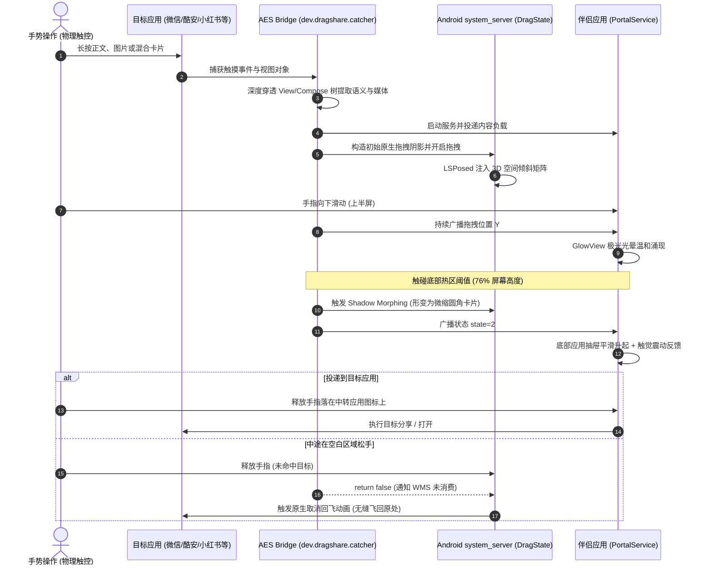

# ohmyAES (DragShare)

> 将 ColorOS 15 流体云 / 内容传送门（DragShare）完整的交互体验与原生流体动效，无缝带到小米 HyperOS！  
> 包含系统级多模态内容识别、ColorOS 极光流光着色器、底部重排变形动画、以及基于 LSPosed 的底层 3D 空间倾斜动画。

[English](README.md) | [简体中文](README_CN.md) | [开发者与 AI 维护指南 (AGENTS.md)](AGENTS.md)

---

## 🌟 核心特性一览

| 模块 | 核心技术 | 功能说明 |
| :--- | :--- | :--- |
| 🎯 **多模态内容提取** | AES 特权挂载 + 混合 View 树穿透 | 深度穿透传统 View、Jetpack Compose 语义树、`AndroidViewsHandler` 混合布局（完美支持酷安动态正文与图片、微信、微博、小红书、Telegram 等）。 |
| 🌈 **ColorOS 极光光效** | AGSL (Android Graphics Shading Language) | 采用自定义 `RuntimeShader` 实现 1:1 动态流动极光，多频噪波扰动，配合手指位移实时动态缩放映射。 |
| 📱 **重排与变形动画** | WMS 动态阴影变形 (Shadow Morph) | 拖拽至底部 76% 热区时，系统拖拽浮层平滑形变为圆角矩形卡片并微缩，底部应用抽屉带触感震动升起。 |
| ↩️ **原生取消回飞动画** | WMS Native Fly-back Restoration | 任意非目标区域松手时，完全还原 Android 底层 WindowManager 物理抛物线飞回原文字/原图位置。 |
| 📐 **3D 空间倾斜动画** | LSPosed `system_server` 挂载 | Hook 底层 `com.android.server.wm.DragState`，通过 `SurfaceControl.Transaction.setMatrix` 直接在 SurfaceFlinger 层面施加真实 3D 倾斜投影。 |
| ✂️ **文本分词** | cppjieba + BigBang 词块 | 文字拖入底部托盘后可进入“文本分词”：本地词典将正文拆成可选词块，支持点选/滑动选词、复制、网页/词典搜索、系统分享与拆字，不上传原文。 |

---

## 🏗️ 交互动效流程



---

## 📁 仓库代码结构

```
ohmyAES/
├── aes/                               # 【组件 1】AES 特权系统服务挂载注入端
│   ├── src/                           # 注入到 AES classes2.dex 的核心 Java 源码
│   │   └── dev/dragshare/catcher/
│   │       └── Bridge.java            # 内容深度穿透提取、触控分发、热区重排动画
│   ├── smali_project/                 # 宿主 Smali 项目（由 apktool 组装 classes.dex）
│   ├── base/                          # 官方基础包 (Application Extension Service_5.1.7.apk)
│   └── patches/                       # 自动化 Smali 补丁注入脚本
│
├── bridge/                            # 【组件 2】DragShareBridge 伴侣应用 & LSPosed 系统模块
│   ├── AndroidManifest.xml
│   ├── src/
│   │   └── com/dragshare/portal/
│   │       ├── MainActivity.java      # 设置与权限引导
│   │       ├── PortalService.java     # ColorOS 极光 GlowView、底部目标抽屉
│   │       ├── PortalReceiver.java    # 跨进程状态广播同步
│   │       ├── PortalFileProvider.java# 跨应用安全文件共享 Provider
│   │       └── system/
│   │           └── PortalSystemModule.java # LSPosed 模块（Hook system_server 实现 3D 倾斜）
│   ├── assets/
│   │   └── oppo_glow.png              # 极光噪波纹理
│   ├── resources/
│   │   └── META-INF/xposed/           # LSPosed 现代模块作用域与元数据
│   └── libs/                          # 编译期 Xposed API 依赖与 Stubs
│
├── tools/                             # 统一构建、打包与设备部署基础设施
│   ├── config.py                      # Android SDK、Build-Tools、Apktool 自动探测
│   ├── build.py                       # 极速双目标构建器（纯源码构建，秒级产出）
│   ├── deploy.py                      # 一键安装、LSP 路径刷新、软重启、日志监听
│   └── repack.py                      # 二进制 AXML versionCode 修改与 DEX 合并
│
├── docs/                              # 技术架构、逆向规范与交付文档
│   ├── ARCHITECTURE.md                # 总体系统架构与 IPC 通信协议
│   ├── COLOROS_VIEWDRAG_SPEC.md       # ColorOS 拖拽交互与动效规范
│   └── COLOROS_COMPOSE_EXTRACTION_SPEC.md # Compose 语义层深度提取规范
│
├── signing/                           # 签名密钥库 (poc.jks)
├── dist/                              # 最终产物输出目录（已加入 .gitignore）
├── AGENTS.md                          # ⚠️ AI Agent 与开发者必须遵守的核心工程守则
├── README.md                          # 英文开源介绍
└── README_CN.md                       # 中文开源介绍
```

---

## 🚀 极速构建与开发

本项目配备了免 Gradle 的自动化极速构建工具链，直接调用 Android SDK 纯底层编译链工具：

### 1. 环境依赖
- **Python 3.8+**
- **JDK 11+**
- **Android SDK**（已配置 `ANDROID_HOME`，包含 `build-tools` 33+ 及 `platforms`）

### 2. 统一构建命令

```bash
# 一键编译全部产物 (DragShareBridge.apk + ContentCatcher-patched.apk)
python tools/build.py all

# 仅构建伴侣应用与 LSPosed 倾斜模块
python tools/build.py bridge

# 仅构建 AES 特权注入包
python tools/build.py aes

# 清除所有中间构建缓存
python tools/build.py clean
```

输出文件将位于 `dist/`：
- `dist/DragShareBridge.apk`
- `dist/ContentCatcher-patched.apk`

---

## 📲 一键部署与调试

```bash
# 1. 一键安装双 APK 并刷新 LSPosed 模块作用域
python tools/deploy.py --install all --refresh-lsp

# 2. 快速软重启 (仅在修改了 system_server 倾斜模块代码后需要执行一次，耗时约 5 秒)
python tools/deploy.py --soft-reboot

# 3. 启动实时日志监听
python tools/deploy.py --logs
```

---

## ❓ 常见问题解答 (FAQ)

<details>
<summary><b>Q1: 为什么硬重启之后倾斜动画会消失？需要每次都软重启吗？</b></summary>

**A:** **日常使用绝对不需要软重启！**  
之前消失是因为在开发调试阶段，刚刚用 ADB 覆盖安装了新包，Android 12+ 会给应用随机生成新哈希路径；此时立即硬重启，导致开机第一秒 LSPosed 读到了已被删除的前一次路径。  
一旦正常运行落盘，APK 物理路径永久固定，**无论冷开机、正常关机还是硬重启，倾斜动画均 100% 自动生效**。唯一需要软重启的时机是：你在电脑上修改了 Hook 代码并刚推了新包。
</details>

<details>
<summary><b>Q2: 为什么中途松手时，原版可以飞回文字原处，有时候会突然直接消失？</b></summary>

**A:** Android 底层 `WindowManagerService` 只有在 `DragEvent.ACTION_DROP` 返回 `false`（表示拖拽未被目标消费）时，才会播放 `createCancelAnimationLocked` 飞回动画。只要任何监听器返回了 `true`，系统就会认为拖拽成功从而瞬间隐藏阴影。本项目已在源码层面严格保证空放时返回 `false`，确保 100% 飞回。
</details>

<details>
<summary><b>Q3: 酷安长按动态为什么以前识别不到？</b></summary>

**A:** 酷安在最顶层套了一个全屏透明拦截的 `CanvasProxyView`（Slidr 滑动返回代理），同时将整个动态 Feed 流包裹在 `ComposeView` $\rightarrow$ `AndroidViewsHandler` $\rightarrow$ `ViewFactoryHolder` 中。传统的 Compose 语义树只能看到空壳。本项目已实现深层穿透算法，跳过伪遮罩层直达正文与图片。
</details>

---

## 🤖 贡献与 AI 协作规范

请在提交任何 Pull Request 或指示 AI Agent 修改代码前，**务必仔细阅读 [AGENTS.md](AGENTS.md)**：
- **严禁向物理设备发送自动化触摸事件**（测试需由人类亲自滑动手势并由 Agent 监听日志）。
- **严禁引入全量兜底截屏**（必须保持 100% 原生多模态语义提取）。
- **严格遵循 76% / 70% 滞后热区阈值** 与 **AGSL 着色器时间取模限制**。

---

## 📄 开源许可证

本项目采用 [GNU General Public License v3.0 (GPL-3.0)](LICENSE) 开源许可证。
