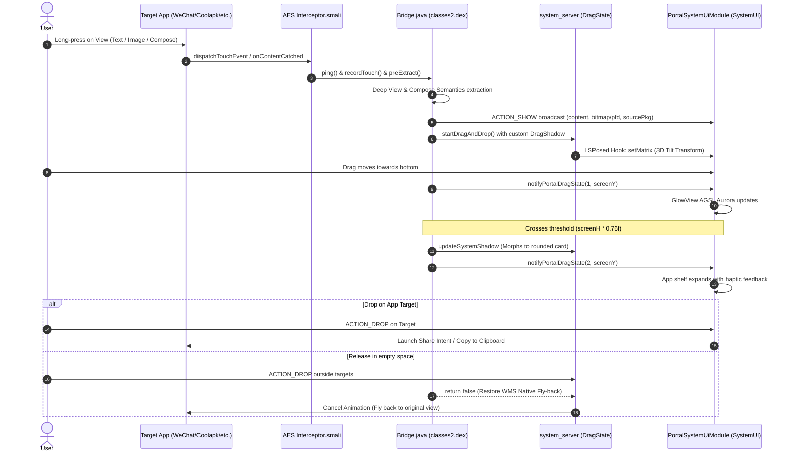

# ohmyAES System Architecture & Protocol Specification

## 1. Overview

ohmyAES transforms the Xiaomi HyperOS content-drag experience into a ColorOS-style fluid cloud drag-and-drop workflow without modifying system framework binaries directly. It achieves this via a dual-component synergy:

1. **Privileged System Plugin Hook (`aes/`)**:
   Injected into `com.miui.contentcatcher` (Application Extension Service), which has `INJECT_EVENTS` and framework-level touch interception in every HyperOS activity.
2. **Companion App & LSPosed Modules (`bridge/`)**:
   The `com.github.leaf.hyperportal` app owns settings, the transfer dock and the BigBang text-segmentation UI. `PortalSystemUiModule` renders the ColorOS Aurora Glow overlay and hosts the bottom shelf targets inside `com.android.systemui`; `PortalSystemModule` injects into `system_server` to manipulate the drag shadow's 3D perspective matrix.



---

## 2. IPC & State Protocol

`Bridge.java` and `PortalSystemUiModule` communicate via directed foreground broadcasts:

| Action / Intent Extra | Direction | Description |
| :--- | :--- | :--- |
| `ACTION_SHOW` (Content Payload) | AES $\rightarrow$ SystemUI | Passes extracted text, bitmap, file PFD or SystemUI staging URI to initialize the drag session. |
| `ACTION_DRAG_STATE` (`state=1`, `y`) | AES / system_server $\rightarrow$ SystemUI | Notifies upper-screen dragging and finger Y coordinate to update Aurora Glow intensity. |
| `ACTION_DRAG_STATE` (`state=2`, `y`) | AES / system_server $\rightarrow$ SystemUI | Finger crossed 76% threshold. Expands bottom shelf app targets. |
| `ACTION_DRAG_STATE` (`state=0`, `y`) | AES / system_server $\rightarrow$ SystemUI | Drag ended or dropped. Dismisses the bottom overlay shelf. |
| `SHADOW_STATE` | system_server $\rightarrow$ AES | Synchronizes the hot-zone state back to the source window shadow updater. |

---

## 3. LSPosed `system_server` 3D Tilt Transformation

In `PortalSystemModule.java`, the hook attaches to `com.android.server.wm.DragState`:
- `notifyLocationLocked(float x, float y)`
- Calculates tilt angles $\theta_x, \theta_y$ based on velocity and screen position:
  $$\begin{bmatrix} X' \\ Y' \end{bmatrix} = \begin{bmatrix} \cos\theta & -\sin\theta \\ \sin\theta & \cos\theta \end{bmatrix} \begin{bmatrix} X \\ Y \end{bmatrix}$$
- Directly calls `SurfaceControl.Transaction.setMatrix` on `mSurfaceControl` during the WMS transaction commit.

---

## 4. Native Cancel Fly-back Mechanism

In Android WindowManagerService, `DragState.createCancelAnimationLocked` calculates a return fly-back trajectory towards `mThumbOffsetX, mThumbOffsetY`.

> [!IMPORTANT]
> If any `OnDragListener` in the source window or overlay window returns `true` on `DragEvent.ACTION_DROP`, WMS marks `mDragResult = true` and skips `createCancelAnimationLocked`.
> Therefore, both `Bridge.java` and `PortalSystemUiModule.SystemUiOverlay` strictly return `false` on `ACTION_DROP` unless the drop lands squarely on an executable `AppTarget`.

---

## 5. SystemUI Host: Never Block the Main Thread

The portal overlay lives in `com.android.systemui` (`PortalSystemUiModule`), so its work is
charged to SystemUI's main thread — the same thread that runs input dispatch. SystemUI is a
persistent process with a 5 s input-dispatch timeout, and the input dispatcher waits for
SystemUI's gesture monitors before delivering a touch to the foreground app.

That makes every blocking cross-process call on that thread a potential device-wide freeze.

### The cold-boot bug this caused

The first drag after a cold boot showed only the `system_server` tilt, no aurora glow and no
shelf; SystemUI then restarted by itself and everything worked.

`handleIntent()` answered `ACTION_DRAG_STATE` by calling `isMasterEnabled()`, which did a
`ContentResolver.call("getConfig")` on the main thread. On the first drag after a cold boot the
HyperPortal process is not running, so `acquireProvider()` waited for it to cold-start. Dropbox
and `/data/anr` capture the exact stack:

```
"main" prio=5 tid=1 TimedWaiting
  at java.lang.Object.wait(Native method)
  at android.app.ActivityThread.acquireProvider(ActivityThread.java:9958)
  at android.content.ContentResolver.call(ContentResolver.java:2557)
  at ...PortalSystemUiModule$SystemUiOverlay.isMasterEnabled(PortalSystemUiModule.java:1021)
  at ...PortalSystemUiModule$SystemUiOverlay.handleIntent(PortalSystemUiModule.java:1103)
  at ...PortalSystemUiModule$SystemUiOverlay$1.onReceive(PortalSystemUiModule.java:990)
```

`Subject: Input dispatching timed out ([Gesture Monitor] mhm-gesture-handle is not responding.
Waited 5000ms for MotionEvent(action=MOVE))` → the system killed SystemUI. The drag's
broadcasts were processed only after the drag was over, so nothing was ever shown; after the
restart the provider was warm and the next drag worked.

### Invariants

- **No provider calls, `PackageManager` queries, icon decoding, or `SharedPreferences` reads on
  the main thread.** They run on `sBgExecutor`; the main thread only reads the resulting cache.
  `getConfig` values are cached (`CONFIG_TTL_MS`) and refreshed asynchronously; the app's
  `ACTION_CONFIG_CHANGED` broadcast carries the same values and is applied directly.
- **Register the drag-state receiver before anything expensive.** `initOverlay()` constructs a
  trivial `SystemUiOverlay`, registers, then warms up. A receiver that does not exist yet is a
  drag that silently shows nothing.
- **Build the overlay views before the first drag, not during it.** A window added mid-drag
  never receives `ACTION_DRAG_STARTED`, so its `AppTarget`s would be dead for that drag. Views
  are built on the first main-thread frame after registration; only the target list is async,
  and `applyTargets()` reveals the shelf if a drag already reached the hot zone.
- **`config_ready` distinguishes "no cache" from "default values".** `SystemUiOverlay`
  serves `getCachedConfigBundle()` to the AES bridge, to `TargetConfig` and to
  `system_server`; a cache that has not yet received a full app snapshot must not be
  treated as authoritative, otherwise the default `bottom` / `76%` values mask the user's
  real trigger edge and threshold. `PortalFileProvider` remains only the bootstrap fallback.

## 6. AES Host: Keep Configuration IPC Out of Touch Dispatch

`Interceptor.dispatchTouchEvent()` calls `Bridge.ping()` before delivering the event to the
foreground app. Configuration has a 5 s cache lifetime. Refreshing it synchronously here
charged provider acquisition, query, cursor extras and release calls to the first touch
after idle. The cost depends on whether SystemUI and the fallback app provider are warm;
it can delay scrolling even when no portal drag is attempted.

- `ensureConfig()` only schedules work on `HyperPortal-Config`. Receiver registration and
  both provider paths run there. One refresh may be pending at a time, including while its
  result waits to be applied, so MOVE events cannot queue more blocked queries.
- Publish provider results on the main thread. A config broadcast increments a revision;
  older in-flight replies must not overwrite the pushed settings. Full app broadcasts apply
  all gesture settings immediately; partial system_server snapshots preserve missing keys
  and request an asynchronous refresh. Failed reads retain the cache and retry after 2 s.
- WebView prefetch waits at least 150 ms and is cancelled once movement exceeds Android's
  scroll slop. It must not use the larger configurable portal drag circle to decide whether
  a normal scroll needs a view-tree/reflection walk. View access and JavaScript evaluation
  still run on the main thread, after this gesture gate.
- Trace sections `HyperPortal.ping`, `HyperPortal.configRefresh` and
  `HyperPortal.webPrefetch` expose these costs in an app-enabled atrace/Perfetto capture.
  A config refresh must appear on the worker, never nested inside main-thread input delivery.

Replacing the AES APK does not replace `Bridge` classes already loaded in app processes.
Reopen the test app to validate new code; device and system process restarts are unnecessary
for this AES-only change.
