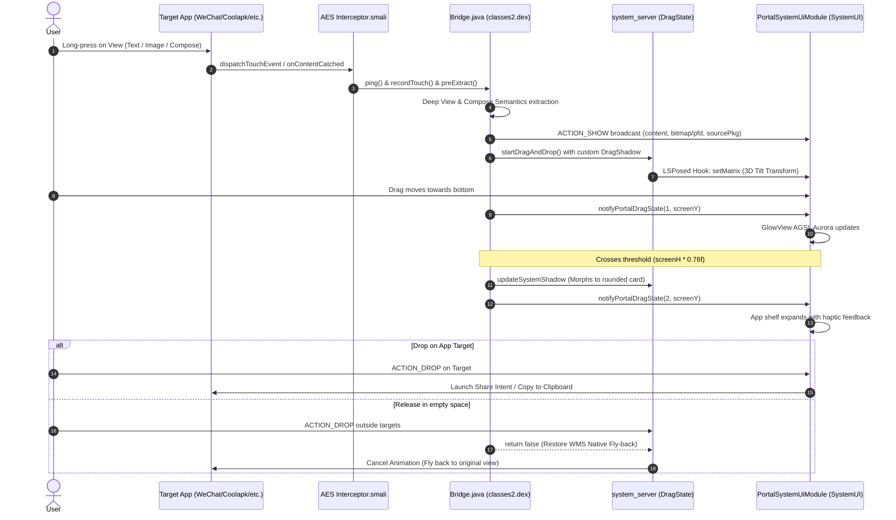

# ohmyAES System Architecture & Protocol Specification

## 1. Overview

ohmyAES transforms the Xiaomi HyperOS content-drag experience into a ColorOS-style fluid cloud drag-and-drop workflow without modifying system framework binaries directly. It achieves this via a dual-component synergy:

1. **Privileged System Plugin Hook (`aes/`)**:
   Injected into `com.miui.contentcatcher` (Application Extension Service), which has `INJECT_EVENTS` and framework-level touch interception in every HyperOS activity.
2. **Companion App & LSPosed Modules (`bridge/`)**:
   The `com.github.leaf.hyperportal` app owns settings, the transfer dock and the BigBang text-segmentation UI. `PortalSystemUiModule` renders the ColorOS Aurora Glow overlay and hosts the bottom shelf targets inside `com.android.systemui`; `PortalSystemModule` injects into `system_server` to manipulate the drag shadow's 3D perspective matrix.



---

## 2. IPC & State Protocol

`Bridge.java` and `PortalSystemUiModule` communicate via directed foreground broadcasts:

| Action / Intent Extra | Direction | Description |
| :--- | :--- | :--- |
| `ACTION_SHOW` (Content Payload) | AES $\rightarrow$ SystemUI | Passes extracted text, bitmap, file PFD or SystemUI staging URI to initialize the drag session. |
| `ACTION_DRAG_STATE` (`state=1`, `y`) | AES / system_server $\rightarrow$ SystemUI | Notifies upper-screen dragging and finger Y coordinate to update Aurora Glow intensity. |
| `ACTION_DRAG_STATE` (`state=2`, `y`) | AES / system_server $\rightarrow$ SystemUI | Finger crossed 76% threshold. Expands bottom shelf app targets. |
| `ACTION_DRAG_STATE` (`state=0`, `y`) | AES / system_server $\rightarrow$ SystemUI | Drag ended or dropped. Dismisses the bottom overlay shelf. |
| `SHADOW_STATE` | system_server $\rightarrow$ AES | Synchronizes the hot-zone state back to the source window shadow updater. |

---

## 3. LSPosed `system_server` 3D Tilt Transformation

In `PortalSystemModule.java`, the hook attaches to `com.android.server.wm.DragState`:
- `notifyLocationLocked(float x, float y)`
- Calculates tilt angles $\theta_x, \theta_y$ based on velocity and screen position:
  $$\begin{bmatrix} X' \\ Y' \end{bmatrix} = \begin{bmatrix} \cos\theta & -\sin\theta \\ \sin\theta & \cos\theta \end{bmatrix} \begin{bmatrix} X \\ Y \end{bmatrix}$$
- Directly calls `SurfaceControl.Transaction.setMatrix` on `mSurfaceControl` during the WMS transaction commit.

---

## 4. Native Cancel Fly-back Mechanism

In Android WindowManagerService, `DragState.createCancelAnimationLocked` calculates a return fly-back trajectory towards `mThumbOffsetX, mThumbOffsetY`.

> [!IMPORTANT]
> If any `OnDragListener` in the source window or overlay window returns `true` on `DragEvent.ACTION_DROP`, WMS marks `mDragResult = true` and skips `createCancelAnimationLocked`.
> Therefore, both `Bridge.java` and `PortalSystemUiModule.SystemUiOverlay` strictly return `false` on `ACTION_DROP` unless the drop lands squarely on an executable `AppTarget`.

---

## 5. SystemUI Host: Never Block the Main Thread

The portal overlay lives in `com.android.systemui` (`PortalSystemUiModule`), so its work is
charged to SystemUI's main thread — the same thread that runs input dispatch. SystemUI is a
persistent process with a 5 s input-dispatch timeout, and the input dispatcher waits for
SystemUI's gesture monitors before delivering a touch to the foreground app.

That makes every blocking cross-process call on that thread a potential device-wide freeze.

### The cold-boot bug this caused

The first drag after a cold boot showed only the `system_server` tilt, no aurora glow and no
shelf; SystemUI then restarted by itself and everything worked.

`handleIntent()` answered `ACTION_DRAG_STATE` by calling `isMasterEnabled()`, which did a
`ContentResolver.call("getConfig")` on the main thread. On the first drag after a cold boot the
HyperPortal process is not running, so `acquireProvider()` waited for it to cold-start. Dropbox
and `/data/anr` capture the exact stack:

```
"main" prio=5 tid=1 TimedWaiting
  at java.lang.Object.wait(Native method)
  at android.app.ActivityThread.acquireProvider(ActivityThread.java:9958)
  at android.content.ContentResolver.call(ContentResolver.java:2557)
  at ...PortalSystemUiModule$SystemUiOverlay.isMasterEnabled(PortalSystemUiModule.java:1021)
  at ...PortalSystemUiModule$SystemUiOverlay.handleIntent(PortalSystemUiModule.java:1103)
  at ...PortalSystemUiModule$SystemUiOverlay$1.onReceive(PortalSystemUiModule.java:990)
```

`Subject: Input dispatching timed out ([Gesture Monitor] mhm-gesture-handle is not responding.
Waited 5000ms for MotionEvent(action=MOVE))` → the system killed SystemUI. The drag's
broadcasts were processed only after the drag was over, so nothing was ever shown; after the
restart the provider was warm and the next drag worked.

### Invariants

- **No provider calls, `PackageManager` queries, icon decoding, or `SharedPreferences` reads on
  the main thread.** They run on `sBgExecutor`; the main thread only reads the resulting cache.
  `getConfig` values are cached (`CONFIG_TTL_MS`) and refreshed asynchronously; the app's
  `ACTION_CONFIG_CHANGED` broadcast carries the same values and is applied directly.
- **Register the drag-state receiver before anything expensive.** `initOverlay()` constructs a
  trivial `SystemUiOverlay`, registers, then warms up. A receiver that does not exist yet is a
  drag that silently shows nothing.
- **Build the overlay views before the first drag, not during it.** A window added mid-drag
  never receives `ACTION_DRAG_STARTED`, so its `AppTarget`s would be dead for that drag. Views
  are built on the first main-thread frame after registration; only the target list is async,
  and `applyTargets()` reveals the shelf if a drag already reached the hot zone.
- **`config_ready` distinguishes "no cache" from "default values".** `SystemUiOverlay`
  serves `getCachedConfigBundle()` to the AES bridge, to `TargetConfig` and to
  `system_server`; a cache that has not yet received a full app snapshot must not be
  treated as authoritative, otherwise the default `bottom` / `76%` values mask the user's
  real trigger edge and threshold. `PortalFileProvider` remains only the bootstrap fallback.

## 6. AES Host: Keep Configuration IPC Out of Touch Dispatch

`Interceptor.dispatchTouchEvent()` calls `Bridge.ping()` before delivering the event to the
foreground app. Configuration has a 5 s cache lifetime. Refreshing it synchronously here
charged provider acquisition, query, cursor extras and release calls to the first touch
after idle. The cost depends on whether SystemUI and the fallback app provider are warm;
it can delay scrolling even when no portal drag is attempted.

- `ensureConfig()` only schedules work on `HyperPortal-Config`. Receiver registration and
  both provider paths run there. One refresh may be pending at a time, including while its
  result waits to be applied, so MOVE events cannot queue more blocked queries.
- Publish provider results on the main thread. A config broadcast increments a revision;
  older in-flight replies must not overwrite the pushed settings. Full app broadcasts apply
  all gesture settings immediately; partial system_server snapshots preserve missing keys
  and request an asynchronous refresh. Failed reads retain the cache and retry after 2 s.
- WebView prefetch waits for the configured long-press threshold and is cancelled once
  movement exceeds Android's scroll slop. Even a 150 ms delay still allowed 150–238 ms
  main-thread walks on Discord's React Native hierarchy before a slow scroll. It must not
  use the larger configurable portal drag circle to decide whether a normal scroll needs
  that work. View access and JavaScript evaluation still run on the main thread, after
  this gesture gate.
- Cache the `isAndroidViewsHandler()` answer per view class, including negative answers.
  Hit-testing calls it outside `viewKind()`'s cache, so ordinary ViewGroups otherwise
  repeatedly enumerate all declared methods up their class hierarchy. Keep the reflective
  fallback for renamed Compose interop classes and continue traversing native children.
- Getter/action reflection uses targeted zero-argument lookups with cached hits and misses.
  All `findMethod()` callers invoke methods without arguments; enumerating every declared
  method for absent Compose getters added substantial allocation on the first long press.
- DOWN only records gesture state. Extract from the node resolved at long-press time;
  the earlier DOWN source snapshot was reverted because a self-drawn image grid can
  contain multiple independently draggable images in one View.
- `recordTouch()` now returns eligibility to the patched native interceptor. A rejected
  timer must return **before** AES traverses the window, rather than merely skipping
  Bridge's bookkeeping. An accepted native attempt that finds no content still leaves
  the fallback alive until a meaningful payload is delivered.
- Trace sections `HyperPortal.aesDispatch`, `HyperPortal.ping`,
  `HyperPortal.configRefresh` and `HyperPortal.webPrefetch` expose these costs in an
  app-enabled atrace/Perfetto capture. `aesDispatch` includes the stock AES detector and
  event-copy overhead after `ping` returns.
  A config refresh must appear on the worker, never nested inside main-thread input delivery.

### First scroll after idle (2026-11-15)

Static inspection found remaining work charged to ordinary touches even after configuration
IPC had been moved off-thread:

- The shadow receiver still registered synchronously in `ping()`. It now registers on
  `HyperPortal-Config` with the config receiver. `Interceptor` calls `Bridge.warmUp()` at
  construction so bootstrap is requested before the first input event. The worker runs
  at Android background priority.
- An expired 5 s config cache used to trigger background provider work at the first touch
  after idle. With a populated cache, refresh is now requested 1 s after UP/CANCEL; the
  next DOWN cancels that deferred request. Bootstrap retries remain asynchronous and
  pushed config still applies immediately. This reduces competition with the initial
  input frame; it does not prove that every observed hitch was caused by config work.
- MOVE cancelled WebView prefetch at Android scroll slop, but the custom long-press timer
  survived until the much larger portal radius. `LongPressGate` now permanently cancels
  prefetch, the fallback, native extraction and late web delivery for a scrolling gesture.
  Batched historical positions count, so moving out and back cannot revive the hold.
  UP/CANCEL and a second pointer also invalidate an unaccepted hold. A completed hold
  retains the user-configured circle around the hold position for starting the drag.
- Stock AES formatted `MotionEvent.toString()` on every event before checking whether
  debug logging was enabled. The debug flag now gates string construction at the caller.
  Bridge also avoids allocating another weak context reference for every MOVE.

The local OPPO binaries were inspected directly with DEX SQL/smali:

| Binary / entry point | Relevant behavior |
| --- | --- |
| `framework.jar`: `ViewRootImpl$ViewPostImeInputStage.processPointerEvent` | Calls the vendor extension in input dispatch; work done there still costs the input thread. |
| `oplus-framework.jar`: `OplusActivityThreadExtImpl.hookHandleBindApplication` → `OplusViewDragManager.init` | Initializes at app binding and posts configuration processing to `OplusViewBackgroundThread`. |
| `OplusViewDragManager.requestConfigLoadAsync` / `isFeatureEnabled` | Coalesces config loads and uses an activity configuration cache, including unsupported activities. |
| `handleActionMove` / `OplusPendingDragState.shouldTriggerDragEvent` | Checks validity, elapsed hold time, pointer count and displacement before target lookup/content processing; invalid gestures are ignored until a new DOWN. |
| `OplusViewDragTouchViewHelper.dispatchTouchView` | Records weak references from actual DOWN dispatch; MOVE does not perform another content-tree scan. This depends on OPPO's per-View framework hooks and is not copied into the AES-only bridge. |

These are useful scheduling and gating patterns, not a portable GPU/CPU boost API. View
access still belongs on the owning UI thread; moving arbitrary View traversal to a worker
would introduce races. Normal scrolling should avoid entering extraction in the first place.

`python -m unittest discover -s tests -v` checks the scroll gate (including diagonal drift,
out-and-back samples and reset) and smali cache invalidation. `tools/build.py aes` hashes its
smali inputs so a changed Java/smali method signature cannot be paired with stale cached
`classes.dex`. Verify the packaged DEX hook signatures as well as compiling Java.

The initial passive trace contained no usable target-app touch samples, so this patch has
no measured before/after frame-time result yet. A subsequent passive trace of installed
commit `742440e` recorded 181 `aesDispatch` calls on Xiaomi Market's main thread: mean 0.020 ms,
maximum 0.066 ms (`ping`: mean 0.013 ms, maximum 0.042 ms). A 58.985 ms config read in
LibChecker ran on `HyperPortal-Config`, not its UI thread. The trace also showed AES
dispatch on an interceptor thread, so the small scroll-gate state uses synchronized
access across dispatch and main-handler callbacks. These samples verify execution paths,
not the user's idle-feed scenario or an improvement percentage.

Physical validation: reopen the test app to
load the new AES code, wait 10–30 s, test both immediate and slowly starting scrolls, then
verify a stationary text/image hold, dragging out of the circle and native cancel fly-back.

Replacing the AES APK does not replace `Bridge` classes already loaded in app processes.
Reopen the test app to validate new code; device and system process restarts are unnecessary
for this AES-only change.
