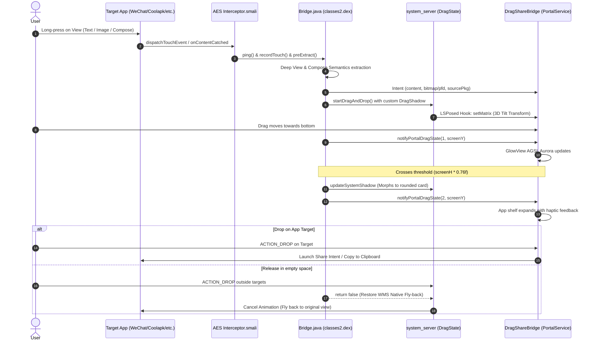

# ohmyAES System Architecture & Protocol Specification

## 1. Overview

ohmyAES transforms the Xiaomi HyperOS content-drag experience into a ColorOS-style fluid cloud drag-and-drop workflow without modifying system framework binaries directly. It achieves this via a dual-component synergy:

1. **Privileged System Plugin Hook (`aes/`)**:
   Injected into `com.miui.contentcatcher` (Application Extension Service), which has `INJECT_EVENTS` and framework-level touch interception in every HyperOS activity.
2. **Companion Service & LSPosed Module (`bridge/`)**:
   Runs as `com.dragshare.portal`, rendering the ColorOS Aurora Glow overlay and hosting the bottom shelf targets, while injecting into Android's `system_server` via LSPosed to manipulate the drag shadow's 3D perspective matrix.

---

## 2. IPC & State Protocol

`Bridge.java` and `PortalService` communicate via directed foreground intents and broadcasts:

| Action / Intent Extra | Direction | Description |
| :--- | :--- | :--- |
| `startForegroundService` (Content Payload) | AES $\rightarrow$ Portal | Passes extracted text, bitmap, file PFD, or image URI to initialize the drag session. |
| `ACTION_DRAG_STATE` (`state=1`, `y`) | AES $\rightarrow$ Portal | Notifies upper-screen dragging and finger Y coordinate to update Aurora Glow intensity. |
| `ACTION_DRAG_STATE` (`state=2`, `y`) | AES $\rightarrow$ Portal | Finger crossed 76% threshold. Expands bottom shelf app targets. |
| `ACTION_DRAG_STATE` (`state=0`, `y`) | AES $\rightarrow$ Portal | Drag ended or dropped. Dismisses the bottom overlay shelf. |
| `SHADOW_STATE` | Portal $\rightarrow$ AES | Synchronizes bottom shelf container state back to source window shadow updater. |

---

## 3. LSPosed `system_server` 3D Tilt Transformation

In `PortalSystemModule.java`, the hook attaches to `com.android.server.wm.DragState`:
- `notifyLocationLocked(float x, float y)`
- Calculates tilt angles $\theta_x, \theta_y$ based on velocity and screen position:
  $$\begin{bmatrix} X' \\ Y' \end{bmatrix} = \begin{bmatrix} \cos\theta & -\sin\theta \\ \sin\theta & \cos\theta \end{bmatrix} \begin{bmatrix} X \\ Y \end{bmatrix}$$
- Directly calls `SurfaceControl.Transaction.setMatrix` on `mSurfaceControl` during the WMS transaction commit.

---

## 4. Native Cancel Fly-back Mechanism

In Android WindowManagerService, `DragState.createCancelAnimationLocked` calculates a return fly-back trajectory towards `mThumbOffsetX, mThumbOffsetY`.

> [!IMPORTANT]
> If any `OnDragListener` in the source window or overlay window returns `true` on `DragEvent.ACTION_DROP`, WMS marks `mDragResult = true` and skips `createCancelAnimationLocked`.
> Therefore, both `Bridge.java` and `PortalService` strictly return `false` on `ACTION_DROP` unless the drop lands squarely on an executable `AppTarget`.
