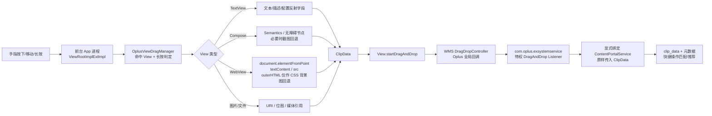
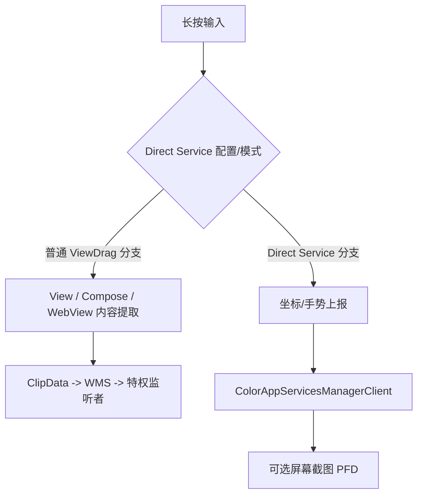

---

## 1. 结论摘要

最重要的结论是：

> `Content Portal` 并不是在长按发生后自行扫描屏幕、读取剪贴板，或以无障碍服务方式遍历前台应用。真正的语义内容首先由 **前台应用进程内的 Oplus framework 扩展** 从被触摸的 `View` / Compose 语义树 / WebView DOM 中提取，打包为 Android 标准 `ClipData`；随后借由 Android Drag-and-Drop 与 `system_server` 的 Oplus 扩展，交给 `com.oplus.exsystemservice` 中受特权权限保护的全局拖拽监听者。该监听者已被证实会把原始 `ClipData`、来源字符串和拖拽 `SurfaceControl` 通过显式 `Intent` 绑定给 `ContentPortalService`。

换言之，系统所说的“长按识别”主要不是 OCR 式的“看图猜文字”，而是一条优先读取**原始结构化内容**的链路：



这解释了几个现象：

- 对原生文本、可访问的 Compose 内容和普通网页文本，结果往往比截图 OCR 更准确，因为源头可直接取得字符或 DOM 属性。
- 同一个长按入口对不同应用的效果会明显不同：是否能获取内容取决于目标页面实际使用的控件、WebView 可否注入脚本、是否配置为可拖拽，以及每个应用的 ViewDrag 策略。
- 拖拽阴影截图与“识别出的内容”是两条不同的数据。前者主要用于视觉预览；后者的主载体是 `ClipData`。
- 普通第三方应用不能仅靠调用一个公开 API 订阅到全局长按内容，因为真正的全局回调注册受 Oplus 特权权限保护。

---

## 2. 证据等级与术语

### 2.1 证据等级

| 标记 | 含义 | 本文中的用法 |
|---|---|---|
| **[已确认]** | 在当前反编译对象中直接看到了类、方法、字段或调用关系。 | 可作为当前 ROM 的实证结论。 |
| **[高可信推断]** | 上下游接口、参数形状和组件职责互相吻合，但连接两端的中间实现 APK 尚未反编译。 | 仅用于仍缺少直接代码的局部问题；本报告此前的 Content Portal 绑定推断已由 `exsystemservice` 代码升级为已确认。 |
| **[待验证]** | 合理的下一步假设，或不同 ROM 可能改变的实现细节。 | 仅作为验证路线，不用于支撑核心结论。 |
| **[当前对象未覆盖]** | 当前加载的 APK/JAR 中不存在该实现类或调用目标。 | 只能说明本次对象无法证实，不能据此判断功能不存在。 |

### 2.2 本文术语

| 术语 | 含义 |
|---|---|
| **内容** | 被快捷操作用于识别/推荐的文本、URI、图片/文件引用、网页元素信息等语义数据；不等同于整屏像素。 |
| **拖拽视觉层** | Android 拖拽期间的 `SurfaceControl` 或拖拽阴影截图，用于动画、定位和预览。 |
| **ViewDrag** | Oplus 在应用进程内对 `View.startDragAndDrop()` 的扩展性触发与内容构造机制。 |
| **Content Portal** | 包名为 `com.oplus.contentportal` 的快捷操作/内容门户应用。 |
| **直接服务（Direct Service）** | `OplusScreenDirectManager` 驱动的另一条全局手势服务路径；它与普通 `ClipData` ViewDrag 路由不同。 |

---

## 3. 全链路分层说明

### 3.1 第 0 层：输入判定发生在前台应用进程

**[已确认]** `android.view.ViewRootImplExtImpl.processPointerEvent(...)` 是这条路径的早期入口之一。它把窗口收到的指针事件交给 Oplus 的 ViewDrag 扩展处理。

后续由 `android.view.viewdrag.OplusViewDragManager.handlePointerEvent(...)` 处理长按相关状态。该类承担的职责包括：

1. 接收按下、移动、抬起/取消等 `MotionEvent` 状态。
2. 记录首次按下的位置和时间。
3. 判断按住时间与位移是否满足触发条件。
4. 根据触点寻找对应的前台 `View`。
5. 将命中的 `View` 交给适配的内容处理器。
6. 由处理器产出拖拽 `ClipData` 后启动 Android 的 drag-and-drop。

**[已确认]** 常规 `OplusViewDragManager` 中观察到的默认长按时长是 **1100 ms**。该阈值可因包名/Activity 的配置而变化；因此它不是一个跨 ROM、跨应用绝对固定的 UX 常量。

触发并不只取决于时间。管理器同时会根据移动阈值/拖拽状态判断是否还应把当前触点认定为长按目标。这样可以避免用户已经开始滚动时误触发内容提取。

### 3.2 第 1 层：从命中的 View 提取原始语义内容

**[已确认]** `android.view.viewdrag.OplusViewDragProcessFactory` 负责选择面向不同 View 类型的处理器。当前证据中至少包含：

- `OplusTextViewDragProcessor`
- `OplusComposeViewDragProcessor`
- `OplusWebViewDragProcessor`
- `OplusFileViewDragProcessor`
- `OplusSmartLoopDragManager`（与智能循环/扩展拖拽策略相关）

这意味着系统不是用一套“拿屏幕截图后统一 OCR”的泛化算法，而是按 UI 技术栈走不同的、优先保留语义的获取器。

在当前 ROM 中，普通工厂按 `File -> Compose -> Text -> Image -> Web` 的顺序调用各处理器的 `isSupport(...)`，并选中第一个返回 `true` 的处理器。因此，配置中的 `ViewDragInfo.type` 与实际命中的 View 类型共同决定分支；它不是根据 View 类名做一次无条件的全局扫描。

### 3.3 第 2 层：用 Android `ClipData` 承载结果并发起拖拽

**[已确认]** 处理器完成后会构造 `ClipData`，并通过 `View.startDragAndDrop(...)` 发起 Android 原生拖拽流程。

当前 `OplusViewDragManager` 的统一启动点可还原为：

```java
ClipData newClipData = assignBitmapPathIfNeeded(view, clipData);
mClipData = newClipData;
view.startDragAndDrop(newClipData, shadowBuilder, null, 769);
```

也就是说，当前版本的 `localState` 为 `null`，flags 原值为 `769`。这些参数不是 TextView、Compose 或 WebView 各自单独决定，而是由三者回调到同一个 manager 后统一设置。

`ClipData` 是 Android 跨组件传递剪贴内容的标准对象。每个 `ClipData.Item` 可以承载：

- `CharSequence` 文本；
- `Uri`（例如图片、文件、媒体内容）；
- `Intent`；
- 配合 `ClipDescription` 的 MIME 类型说明。

因此，要理解“长按识别出了什么”，最有价值的观察点不是最后的推荐 UI，而是这一刻创建的 `ClipData` 内容。它通常已经包含了可供后续识别的原始数据。

### 3.4 第 3 层：`system_server` 将拖拽事件送到 Oplus 全局监听者

**[已确认]** Android WMS 的拖拽执行路径被 Oplus 扩展接入：

```text
View.startDragAndDrop(ClipData)
  -> DragDropController.performDrag(...)
  -> DragAndDropControllerExtImpl.postPerSuccessformDrag(...)
  -> OplusGlobalDragAndDropCallback.postPerSuccessformDrag(...)
  -> DragAndDropDispatcherManagerService.dispatchPrePerformDrag(...)
  -> IDragAndDropListener.prePerformDrag(...)
```

类名 `postPerSuccessformDrag` 的拼写看起来像厂商代码中的既有拼写，不应擅自改写为标准英文；检索时应使用反编译中出现的原始名字。

**[已确认]** `com.android.server.wm.OplusWindowManagerServiceEx.systemReady(...)` 会创建/注册 `OplusGlobalDragAndDropCallback`。

**[已确认]** `OplusGlobalDragAndDropCallback.postPerSuccessformDrag(...)` 向下游提供了以下类型的数据：

- 源窗口名称；
- 拖拽 `SurfaceControl`；
- 一个 `Bundle`，其中已观察到 `touchSource` 和 `pointArray`；
- 原始 `ClipData`。

`SurfaceControl` 是渲染/合成层对象，它能帮助下游表现拖拽影子或定位画面，但它本身不是文本、DOM 或文件内容的主要来源。

### 3.5 第 4 层：`com.oplus.exsystemservice` 的特权监听者与 Content Portal

**[已确认]** `DragAndDropDispatcherManagerService.dispatchPrePerformDrag(...)` 会向注册的 `com.oplus.globaldrag.IDragAndDropListener` 分发事件。

**[已确认]** 该监听者的注册入口位于：

```text
com.android.server.wm.OplusActivityTaskManagerServiceEnhance
  .registerDragAndDropListener(...)
```

并要求权限：

```text
oplus.permission.OPLUS_COMPONENT_SAFE
```

这是一条关键权限边界。没有该签名/特权级权限的普通应用，不能合法注册为全局拖拽监听者并直接获得其他应用发起的这类全局 `ClipData`。

**[已确认]** `com.oplus.contentportal` 中的 `ContentPortalService.onBind(Intent)` 会读取：

- `Intent` extra：`"clip_data"`，类型为 `ClipData`；
- `Intent` extra：`"drag_pkg_detail"`，来源/拖拽包相关元数据；
- `Intent` extra：`"surface_control"`，拖拽视觉层数据；
- 外部处理 Binder：`IExSystemServiceHandler`；
- `getDragShadowViewScreenShot()` 相关拖拽阴影视图截图接口。

**[已确认]** 最后一跳的实现位于 `com.oplus.exsystemservice` 的混淆类 `p229r7.C2948a`。该类在日志中自称 `ContentPortalDragAndDropManager`，且会在 `OplusSystemServiceApplication.onCreate()` 中初始化。APK 的 manifest 表明它以 `android.uid.system` 运行，并声明了 `oplus.permission.OPLUS_COMPONENT_SAFE`；这与 system_server 对监听者注册的权限要求闭合。

它的初始化逻辑等价于：

```java
if (isContentPortalEnabled()) {
    DragAndDropDispatcherManager.getInstance()
        .registerDragAndDropListener(context.getPackageName(), callback);
}
```

`isContentPortalEnabled()` 的实现还受产品特性控制：对于非 REALME 品牌，会检查 feature `com.oplus.contentportal.dragservice_disable`；REALME 分支会直接禁用该服务。换句话说，即便 framework 已经生成了 `ClipData`，产品特性开关仍可能让 Content Portal 监听端不注册。

真正的回调为：

```java
prePerformDrag(String dragPkgDetail,
               SurfaceControl surfaceControl,
               Bundle ignoredBundle,
               ClipData clipData)
```

处理顺序已经可以精确还原：

1. 若上一次 `ContentPortalService` 仍绑定，先 `unbindService()`；若保留着旧 `SurfaceControl`，先 `release()`。
2. 用 `m17481r(clipData)` 做准入过滤；不通过时立即返回，**不会绑定 Content Portal**。
3. 通过时把 `surfaceControl` 保存到成员字段。
4. 调用 `m17479o(context, dragPkgDetail, clipData)`，显式绑定目标包 `com.oplus.contentportal`。

绑定 Intent 的实际字段如下，均不是猜测：

```java
Intent intent = new Intent();
intent.setAction("com.oplus.contentportal.intent.action.CONTENT_PORTAL_SERVICE");
intent.setPackage("com.oplus.contentportal");
intent.putExtra("drag_pkg_detail", dragPkgDetail); // 仅非空时
intent.putExtra("clip_data", clipData);            // 原对象，未在这里重建 Item
intent.putExtra("surface_control", surfaceControl); // 仅非空时
context.bindServiceAsUser(intent, connection, 524289,
                          new UserHandle(ActivityManager.getCurrentUser()));
```

其中 `524289` 等于 `BIND_AUTO_CREATE (1)` 与 `BIND_ALLOW_ACTIVITY_STARTS (0x80000)` 的组合。这说明服务会按当前用户启动/绑定，并获准为该拖拽会话发起 UI；不应把它误解为一次普通、无 UI 权限的后台绑定。

**重要细节：WMS 的 `Bundle` 在这个版本的桥接回调中没有被继续传入 Content Portal。** 回调虽然接收四个参数，但源码只把第一个字符串、`SurfaceControl` 和 `ClipData` 写进 Intent。此前 WMS 侧看到的 `touchSource`、`pointArray` 因此不能据此宣称已到达 Content Portal；它们至少在这一段 `C2948a` 代码中被忽略。

### 3.6 Content Portal 准入过滤：哪些 `ClipData` 会被拦截

`C2948a.m17481r(ClipData)` 的过滤逻辑也已确认。只有同时满足以下条件的拖拽才会继续绑定 Content Portal：

1. `clipData != null`；
2. `clipData.getItemCount() > 0`；
3. `ClipDescription` 不匹配 MIME 模式 `card/*`；
4. `ClipDescription.getExtras().getBoolean("is_folder", false)` 不是 `true`；
5. `ClipDescription.getExtras().getBoolean("disable_content_portal", false)` 不是 `true`。

等价伪代码：

```java
boolean allowed = clipData != null
    && clipData.getItemCount() > 0
    && !description.hasMimeType("card/*")
    && !description.extras.getBoolean("is_folder", false)
    && !description.extras.getBoolean("disable_content_portal", false);
```

这给出了“为什么某些长按不会弹出快捷操作”的一个明确答案：应用或 framework 处理器可以在 `ClipDescription` 中设置 `disable_content_portal=true`，或者把内容标记为文件夹/卡片，从而在系统桥接端被干净地拒绝。它不是靠 Content Portal UI 再去猜测是否应显示。

---

## 4. 不同内容类型是如何取得的

### 4.1 文字：`TextView` 路径

**[已确认]** `OplusTextViewDragProcessor.processView(...)` 的内容逻辑很短：先执行 `extractTextFromView(view)`；只要结果非空，就构造 `ClipData.newPlainText("content", text)`，再把该数据和文本拖拽阴影交给 manager。`MotionEvent` 只参与阴影的尺寸/偏移计算，**不参与文字提取**。

#### 4.1.1 当前 ROM 的提取顺序

`extractTextFromView(...)` 的实际优先级如下：

1. 若应用配置同时给出 `textFieldPath` 和 `textKeyWord`，先通过反射路径读取一个候选字符串；它此时只是候选值，不会自动覆盖正文。
2. 基础文本优先取 `TextView.getWrapper()` 中 `ITextViewWrapper.getText()` 返回的 `CharSequence`。
3. 基础文本为空时，才取 `view.getViewWrapper().getContentDescription()`。
4. 对步骤 1 的候选值调用 `chooseTextByRule(...)`。只有基础文本非空、包含配置关键词、两者前 3 个字符相同，并且候选值含 `https` 或候选值中的关键词出现次数更少时，候选值才覆盖基础文本。
5. 若仍未覆盖，遍历 `newFilePath` 配置的反射路径，按同一规则尝试覆盖。基础文本为空时，此分支直接返回，不能凭空从反射路径产生文本。

因此，它不是“反射优先”的通用爬取器。标准 `TextView` 文本是基础值，`contentDescription` 只是空文本回退，反射路径只服务于满足特定比对条件的已适配应用。

| 问题 | 当前代码结论 |
|---|---|
| 选区范围 | 直接传入整个 `CharSequence`；`extractTextFromView(...)` 不读取 `MotionEvent`、选区起止、字符 offset 或 Layout。当前实现没有“按长按坐标取词/取行”的分支。 |
| 文字优先级 | `getText()` -> `contentDescription`（仅前者为空时） -> 满足规则的反射候选覆盖。没有 TextView 内的 URI/图片回退。 |
| `ClipDescription` | `ClipData.newPlainText("content", text)` 会创建 label 为 `content`、MIME 为 `text/plain` 的单个 `Item(text)`；该处理器未写入 extras，也未写入 `disable_content_portal`。 |
| `CharSequence` 形态 | `newPlainText` 接收原始 `text`，本处理器在构造 `ClipData` 前没有调用 `toString()`。后续跨进程的 `Spanned` 序列化效果属于 Android `ClipData`/Parcel 行为，不应从本方法单独推断。 |
| 拖拽参数 | 回到统一 manager 后以 `localState=null`、flags `769` 调用 `View.startDragAndDrop(...)`。 |

#### 4.1.2 这对移植意味着什么

```text
TextView 当前持有的 CharSequence -> ClipData.Item
屏幕像素 -> OCR -> 猜测字符串                  （不是该 TextView 主路径）
```

对于低端机复刻，若目标只是相同的文本行为，应优先复刻“取控件完整 `CharSequence` + 空值时取 `contentDescription` + `text/plain` ClipData”，而不是先做 OCR。`maxLines`、椭圆省略和滚动不会让该方法按可见像素裁字；它取的是控件当前持有的文本对象。

该路径仍受 `ViewDragInfo.type == "text"` 和应用配置约束。自绘 Canvas、OpenGL、游戏引擎或把字画入 Bitmap 的界面没有标准 `TextView.getText()` 数据源，不能因该分支存在就自动获得结构化文本。

### 4.2 Jetpack Compose：语义树优先，图像回退其次

**[已确认]** 当前 `OplusComposeViewDragProcessor` 的实现不是笼统扫描整棵树。它先把触点换算为 Compose View 内坐标，然后只收集 `boundsInRoot.contains(touchX, touchY)` 的 Semantics 节点，并跳过标记为 link 的节点。

命中候选的排序规则已可还原，优先级依次为：

1. 有文本的节点优先于无文本节点；
2. 图像节点优先于普通非文本节点；
3. 非容器、且深度大于 0 的节点优先；
4. 深度更大的节点优先；
5. 深度相同时，面积更小的节点优先。

选中的 owner 节点若有文本，立即走 `SEMANTICS_TEXT` 并以 `ClipData.newPlainText("content", text)` 交付；若是图像节点且有边界，走 `SEMANTICS_IMAGE`，将 **该节点边界** 从 Compose View 位图中裁出。

若 owner 节点没有可直接交付的内容，框架尝试同一语义行的文本，顺序为：嵌入的 `TextView` 文本 -> 该行 Semantics 子树文本 -> 无障碍 provider 行文本 -> 配置反射路径文本。仍失败后，才查询同一触点命中的无障碍节点；其候选排序为“有文本 -> 深度更大 -> 面积更小”，文本优先取 `AccessibilityNodeInfo` 文本，非图像节点才回退 `contentDescription`。

#### 4.2.1 Compose 的截图/图片降级是怎样发生的

图像与无文本节点不会直接交出整屏截图：

- Semantics 图像按该 Semantics 的 View 内边界裁图；
- 无障碍图像按命中的 `AccessibilityNodeInfo` 屏幕边界换算到 View 后裁图；
- 普通无文本无障碍节点只有在非根节点、边界有效且面积小于整个 Compose View 的 85% 时，才走 `FALLBACK_CROP`；
- 没有可裁边界时才考虑 `FULL_COMPOSE`，即对整个 Compose View 调用 `view.draw(canvas)`；但如果触点仍位于一个非图像的文本行内，框架会返回 `TEXT_NOT_FOUND`，刻意跳过整 View 截图。

裁图坐标会乘以传入的 `bitmapScale`，并被裁剪到位图边界。位图随后以 PNG 写入 `/sdcard/Download/...` 下的临时路径、扫描为 MediaStore 内容 URI，再异步交给拖拽回调形成 URI 型 `ClipData`；它不是把 Bitmap 直接塞进 Binder。该 `ClipData` 会额外携带一个包含缓存路径的文本 Item；manager 识别路径中含 `OPLUSDRAG` 的 Item 后，将它写入 View attach info，并重建为只保留第一个 URI Item 的 `ClipData` 传给 `startDragAndDrop(...)`。

这说明 Compose 路径的优先次序是：**触点命中 Semantics 文本/图像 -> 同行文本 -> 触点命中无障碍文本/图像 -> 小范围裁图 -> 整个 Compose View 位图**。截图在该 ROM 中是已确认的 Compose 降级分支，但它只属于被配置为 Compose 的处理器，不能据此推出所有 Canvas/GL 页面都会自动截图。

### 4.3 网页：`WebView` 的 DOM/JavaScript 路径

**[已确认]** 当前 WebView 分支先计算 CSS 坐标：

```text
touchX = (ev.getX() - view.getLocationInWindow()[0]) / displayDensity
touchY = (ev.getY() - view.getLocationInWindow()[1]) / displayDensity
```

然后执行 `document.elementFromPoint(touchX, touchY)`。JavaScript 返回一个数组，依次包含命中元素的 `textContent`、`outerHTML`、`src`、`getBoundingClientRect()` 的 `x/y/width/height`、CSS `font-size`、`line-height`，以及是否位于若干 article 容器内。当前回调把字符串解析为 `JSONArray`，用边界和字体参数构造拖拽阴影。

#### 4.3.1 当前代码实际交付什么

1. `textContent` 非空且 trim 后仍非空时，优先调用 `startDragText(...)`，交付 `ClipData.newPlainText("content", text)`。
2. 只有文本为空时，才处理 `src`。若 `src` 为空，会从 `outerHTML` 中以 `url\((.*?)\)` 提取 CSS 背景图地址；`outerHTML` 本身不会成为 `ClipData` 的 HTML Item。
3. 图片分支在后台用 `new URL(src).openStream()` 下载字节，解码后以 PNG 写入下载目录下的临时文件，再扫描为 MediaStore 内容 URI 并构造 URI 型 `ClipData`。下载、解码、文件写入或扫描失败时，当前分支只会失败，不会退回 OCR。

因此，网页分支的输出是**文本或本地化后的图片 URI**，不是“文本、HTML 片段或原始 `src` 三选一”。对于同时拥有文字和图片 `src` 的元素，文字优先。CSS 背景图只在 `src` 缺失且元素文本为空时才会作为图片来源。

该处理器只接受 `ViewDragInfo.type == "web"` 的配置。标准 `WebView` 直接调用 `evaluateJavascript(...)`；对定制 WebView，它会从配置的 `evaluateJs` 方法名或名为 `evaluateJavascript` 的双参数方法中反射选择 bridge。Canvas、受限脚本环境、没有匹配 bridge 的定制 WebView，均不会得到此 DOM 提取结果。

### 4.4 图片与文件：`Uri` 和媒体引用路径

**[已确认]** 图片/文件相关处理器会把数据组织为 `ClipData` 中的 URI，且存在位图缓存、媒体 URI 转换相关能力。`OplusFileViewDragProcessor` 是已发现的文件类处理器。

这意味着“识别到一张图/一个文件”并不必然表示内容门户收到了图片的像素副本。优先形式往往可能是一个 `Uri`；是否能在下游打开它，取决于：

- URI 的 scheme 与指向对象；
- Drag-and-Drop / ContentProvider 是否附带读权限；
- 下游是否具备读取相应 provider 的权限；
- 是否在某些分支中改为缓存位图或截图。

### 4.5 输入类型对照表

| 命中对象 | 优先内容来源 | 预期 `ClipData` 形态 | 主要回退/局限 | 证据等级 |
|---|---|---|---|---|
| 标准 `TextView` | 完整 `getText()`；空值时 `contentDescription`；满足规则时反射候选覆盖 | 单个 `text/plain` 文本 Item，label=`content` | 不按坐标取词；自绘文本无此数据源 | 已确认 |
| Compose UI | 触点命中 Semantics 文本/图像；随后同行文本和无障碍节点 | `text/plain` 文本或媒体 URI | 节点裁图，再到完整 Compose View 位图 | 已确认 |
| WebView 文本/图片 | `elementFromPoint(x,y)` 的 `textContent`；空文本时 `src` 或 CSS `url(...)` | `text/plain` 文本或本地化图片 URI | Canvas、脚本受限、bridge 不匹配会失败；`outerHTML` 不直接交付 | 已确认 |
| 图片 | 图片/媒体 URI，必要时位图缓存 | URI 或图像相关数据 | URI 读取权限、缓存策略 | 已确认 |
| 文件 | 文件 URI/拖拽数据 | URI | 来源应用/Provider 的授权 | 已确认 |
| 游戏、Canvas、自定义 GL | 当前没有通用结构化提取路径 | 未由本次代码证明存在通用输出 | Compose 截图回退不等于所有 Canvas/GL 都会截图 | 当前对象未覆盖 |

---

## 5. Content Portal 自身做了什么，以及没有做什么

### 5.1 已确认的输入消费行为

`ContentPortalService.onBind(Intent)` 的职责是接收来自上游的拖拽上下文，而不是从零开始发现前台界面的内容。`"clip_data"` 是最关键的语义输入：其中的文本或 URI 将被用于后续快捷操作匹配与推荐。

`"drag_pkg_detail"` 可用于判断来源应用、拖拽类型或策略；`"surface_control"` 用于视觉层/拖拽表现；外部 `IExSystemServiceHandler` Binder 可能承载与系统服务协作、回调或会话控制。

### 5.2 明确排除的主采集模式

在当前 Content Portal APK 中，**没有发现**以下内容作为主语义采集通道：

- 本地全局 `OnLongClickListener` / 全局触摸监听来遍历其他应用；
- 以 `AccessibilityService` 抓取其他应用节点树；
- 轮询或扫描系统剪贴板来获得长按内容；
- 先抓取整屏再统一 OCR 作为标准主路径。

这不是说系统中绝不会存在某个截图/OCR 辅助分支，而是说上述方式不是当前已见 Content Portal 的主输入设计。证据更支持“前台应用进程先提取、后端服务消费 `ClipData`”的模型。

### 5.3 拖拽阴影截图的正确定位

`getDragShadowViewScreenShot()` 相关代码容易造成误判。它提供的是拖拽阴影/视觉预览，而不是证明 Content Portal 把整张图 OCR 后才得到文本。

正确理解应为：

- **`ClipData`**：优先承载可操作的语义内容；
- **`SurfaceControl` / drag shadow screenshot**：承载拖拽动画、预览、位置关联等视觉上下文；
- **截图/OCR**：在某些 UI 技术栈或直接服务路径中可能是降级/补充，而不是本次已确认普通 ViewDrag 主链的首选数据源。

### 5.4 `IContentPortalHandler` / `IExSystemServiceHandler`：拖拽会话的双向 Binder

补齐 `exsystemservice` 后，可以确认两端不只是一次性传 Intent，而是建立了会话 Binder：

1. `exsystemservice` 绑定 `ContentPortalService` 后，将返回 Binder 解析为 `com.oplus.contentportal.aidl.IContentPortalHandler`。
2. 它调用 `IContentPortalHandler.setExSystemServiceHandler(IExSystemServiceHandler)`（反编译混淆名为 `mo5831T`），把自己的回调 Binder 交给 Content Portal。
3. Content Portal 可调用 `IExSystemServiceHandler.getDragShadowViewScreenShot()`，取得当前拖拽阴影对应 `SurfaceControl` 的截图。
4. Content Portal 可调用 `IExSystemServiceHandler.handleDragEvent(Bundle)`，用 `eventType` 控制 `dismissDragShadowView` / `showDragShadowView`；桥接端通过 `SurfaceControl.Transaction.setVisibility(...)` 隐藏或显示阴影。
5. exsystemservice 在 `postPerformDrag`、`postEndDrag`、`postCancelDragAndDrop`、`postReportDropResult`、`preReportDropResult` 等阶段向 `IContentPortalHandler` 回传 `Bundle`，其中至少包含 `eventType`，`preReportDropResult` 还可带 `dropPageInfo`。
6. 拖拽结束、取消或服务连接死亡时，桥接端解绑服务并 `release()` 保存的 `SurfaceControl`。

因此，`surface_control` 在 Intent 中的意义已经可以更加精确地描述：它不是内容文本的来源，而是让 Content Portal 在拖拽期间取得/控制拖拽阴影视觉层的系统对象。截图 API 的设置为 `mFullDisplay=false`、`mLayer=surfaceControl`、裁剪区域为该 layer 的完整宽高；即截的是 **拖拽影子层**，不是整屏截图。

### 5.5 文件数据的 URI 中转：`ViewDragService` 与 `ViewDragProvider`

`com.oplus.exsystemservice` 还暴露了另一个和内容获取有关、但不同于 Content Portal 绑定的系统服务：

```text
Service:  com.oplus.exsystemservice.viewdrag.service.ViewDragService
Action:   com.oplus.exsystemservice.action.ViewDragService
Binder:   android.view.viewdrag.IExSystemServiceFileUriHandler
Provider: content://com.oplus.exsystemservice.ViewDragProvider/...
```

它的 Binder 方法 `getDragUriFromFile(ParcelFileDescriptor, originalPath, fileName)` 接收文件描述符，创建形如以下的临时 URI：

```text
content://com.oplus.exsystemservice.ViewDragProvider/data/<calling-package>/<timestamp>/<encoded-name>
```

然后执行如下动作：

1. 根据原路径或文件名提取扩展名；
2. 从 `Binder.getCallingUid()` 解析调用方包名；
3. 缓存原始 `ParcelFileDescriptor`、显示文件名、大小、原路径、调用方和创建时间；
4. 对调用方授予该 URI 的读权限；当显式文件名存在时，还授予写权限；
5. `ViewDragProvider.openFile()` 从缓存复制 FD 并 seek 到文件开头；`query()` 返回 `_display_name` 与 `_size`；`getType()` 由文件名/URI 扩展名推导 MIME 类型；
6. 每次新建缓存都重置清理计时器，约 **360000 ms（6 分钟）** 后清空所有缓存；若收到 `DragEndEvent` 且 `DragResult=false`，会提前按 URI 清除缓存。

这解释了文件类拖拽如何在不把整个文件塞进 `ClipData` Parcel 的情况下交给下游：`ClipData` 可以携带一个受授权的临时 `content://` URI，而实际字节仍由 system UID 的 Provider 按需通过 FD 提供。它也意味着文件 URI 不是永久链接，拖拽完成/超时后读取可能失败。

---

## 6. 独立的 Direct Service 手势路径

当前系统服务中还发现了另一套不等同于 `ClipData` ViewDrag 的全局手势机制，必须与上述主链分开。

### 6.1 已确认的调用特征

相关类：

```text
com.android.server.oplus.input.exinputservice.globalgesture.OplusScreenDirectManager
```

**[已确认]** 该路径受以下系统设置影响：

```text
Settings.System.direct_service_field == 1
```

它可在全局指针输入层监听手势，并在长按时绑定：

```text
com.coloros.colordirectservice.ColorAppServicesManagerClient
```

已看到其向远端传递按压坐标、指针数量和按压类型等信息。

**[已确认]** 两指长按相关分支可以执行 `screenCapture()`，以 JPEG 质量 `80` 写入 `ParcelFileDescriptor`，再通过：

```text
IScreenDirectGestureCallBack.onSetScreenshotFileDescriptor(...)
```

把截图文件描述符交给远端。

### 6.2 与 ViewDrag 的关系

**[已确认]** 当直接服务处于某些模式（已观察到模式 `0` / `3`）时，`OplusViewDragManager` 会刻意跳过普通 ViewDrag 处理。因此不能把“全局截图直连服务”和“前台 View 生成 `ClipData`”简单拼成同一条必经链。

更准确的关系是：



**[当前对象未覆盖]** 本次切回的 `framework` 中检索不到 `ColorAppServicesManagerClient`、`IScreenDirectGestureCallBack` 或 `ContentPortalService` 的远端实现，因此不能据此确认 Direct Service 最终是否再调用 Content Portal。该问题只能由同版本 `com.coloros.colordirectservice.apk` 的代码回答；在拿到该 APK 前，应把它视为独立分支，而不是普通 ViewDrag 的一段。

---

## 7. 配置、白名单与“为什么有些应用没有内容”

### 7.1 应用级配置注入

**[已确认]** `android.app.OplusActivityThreadExtImpl.hookHandleBindApplication(...)` 会从 `ApplicationInfoExt.getViewDragExtraBundle()` 读取并注入 ViewDrag 扩展配置。

当前已看到这些配置类别：

- `PackageDragConfigInfo`；
- SmartLoop 相关配置；
- Binder 句柄；
- 面向包名/Activity 的可配置参数。

它们说明这项能力并非只由一个统一的“长按 1100 ms”开关决定。系统可以按应用、页面、控件类型调整是否启用、触发条件、内容获取策略和专用处理逻辑。

### 7.2 “不能勾选目标应用”的含义

如果用户界面中无法自由选择目标 App，最可能的工程解释是配置/策略由系统侧下发，而不是 Content Portal 让普通用户对所有包名逐项授权。当前证据能够确认存在 `PackageDragConfigInfo` 和应用级额外 Bundle，但还不能仅据此断言其精确字段或完整白名单规则。

可能影响某 App 能否被处理的因素包括：

- ROM 的包名/Activity 配置是否启用 ViewDrag；
- 命中的控件是否被对应处理器支持；
- 页面是否处于 Direct Service 规避普通 ViewDrag 的模式；
- 应用本身是否设置了禁止拖拽、窗口安全标志或自定义触摸逻辑；
- WebView/Compose 的语义与脚本桥接是否可用；
- 系统版本与目标应用版本组合。

因此，“某个应用没出现快捷操作”不能直接推出“Content Portal 无法读它”；也不能反过来推出“系统在偷读整页”。更可靠的诊断方法是查看该应用进程是否创建了 `ClipData`、`ClipData` 是否到达 WMS，以及是否被监听者接收。

---

## 8. 权限边界、可移植性与对外暴露的现实限制

### 8.1 为什么普通 App 不能直接复用这条链

普通 Android 应用没有能力：

1. 在其他应用进程中访问其 `View`、Compose Semantics 或 WebView DOM；
2. 注册受 `oplus.permission.OPLUS_COMPONENT_SAFE` 限制的全局 `IDragAndDropListener`；
3. 任意读取其他应用在 Drag-and-Drop 中携带的私有 URI；
4. 任意获得 WindowManager 的 `SurfaceControl` 或全局输入事件。

也就是说，`ContentPortalService` 只是下游消费者。即使把它的 `onBind()` 行为“暴露给第三方 App”，第三方也仍缺少上游产生的可信 `ClipData` 和受权限保护的拖拽会话。

### 8.2 仅有 `framework.jar` 能还原到什么程度

若提供同一机型、同一 ROM 版本的完整 `framework.jar` / `oplus-framework.jar`，通常可以非常完整地还原以下部分：

- 指针事件如何进入 `OplusViewDragManager`；
- 长按/位移阈值和包级配置如何判定；
- 支持哪些 View 类型；
- 每种处理器从哪些字段、节点、DOM 属性或 URI 取数据；
- `ClipData` 的具体构造、MIME 类型、附加 `Bundle` 和 `startDragAndDrop` flags；
- Compose/WebView/图片回退分支的精确条件。

在本次补齐 `com.oplus.exsystemservice.apk` 后，普通 ViewDrag 主链中“监听回调 -> 绑定 `ContentPortalService` -> 传递 Intent extras”的部分已经确认。`framework.jar` **单独仍不能保证**还原全部产品行为：

- Direct Service 的实际远端逻辑可能在 `com.coloros.colordirectservice.apk`；
- 服务器下发或 ROM 配置文件会改变最终行为。
- 本次已用当前同版本 framework 核对 TextView / Compose / WebView 的主 `ClipData` 构造；文件、图片处理器和 URI grant 的完整差异仍需单独核对。

### 8.3 LSPosed / Zygisk 的可行性边界

从纯技术架构看，若在其他机型上复刻“内容获取”而非只做截图，必须把代码放到能看到目标应用 UI 对象的位置：

- **LSPosed 应用进程注入**：可在目标应用进程中 Hook `View`、`TextView`、`WebView` 或 drag 创建点，得到与当前 Oplus 路径相近的语义数据。代价是模块需要在每个目标进程中加载，兼容性和崩溃面较大。
- **Zygisk/zygote 级注入**：能更早介入进程创建或框架类加载，但并不会自动获得“所有应用的 View 内容”。仍需在相关应用进程或系统进程落点 Hook，并处理不同 Android 版本/厂商实现差异。
- **`system_server` Hook**：适合观测已经到达 WMS 的 `ClipData`，但只覆盖已进入 drag-and-drop 的内容，不能凭空恢复未被前台应用处理器提取的语义。
- **无障碍服务**：可在用户显式授权后读取一部分可访问节点，属于替代方案，覆盖与准确性通常低于进程内 ViewDrag；不能等价替代 WebView DOM 或私有 Compose 语义。
- **截图 + OCR**：覆盖广，但不是结构化内容获取；准确率、性能、语言模型依赖和隐私暴露都更差。

“不勾选目标应用”在工程上并不等于可安全地获得所有应用内容。若一个模块被设计成无差别注入/采集所有前台 App，它会形成严重的隐私、兼容性和审计问题；在正常可控的实现中，应使用明确的 allowlist、前台状态检查、用户授权和最小化数据收集。

### 8.4 修改/挂载系统 Framework 的风险

把改过的 framework 文件挂载回系统可在已解锁、可恢复的测试机上验证机制，但它不是把能力“安全暴露给任意 App”的充分条件。

主要风险和约束：

- Android Verified Boot、动态分区、SELinux、dex/oat 缓存与签名/完整性校验均可能阻止加载或造成启动失败；
- framework 与 services、SystemUI、厂商 APK 的接口版本必须匹配；
- 直接扩大跨应用内容访问会破坏 Android 沙箱和用户隐私模型；
- 真实可交付设计应把跨进程访问收敛为受签名权限保护的系统服务，再通过窄化 AIDL 接口提供经过授权、最小化后的结果，而不是把原始全局 `ClipData` 广播给任意应用。

---

## 9. 数据包对应关系：已确认与当前对象未覆盖项

| Content Portal 可见输入 | 上游候选来源 | 证据情况 | 说明 |
|---|---|---|---|
| `clip_data` (`ClipData`) | 前台 ViewDrag 处理器创建，WMS 回调继续携带 | **已确认** | `C2948a` 原样写入显式绑定 Intent。 |
| `surface_control` | WMS 的拖拽 `SurfaceControl` | **已确认** | `C2948a` 保存并写入 Intent；同时作为拖拽阴影截图/显隐控制的 layer。 |
| `drag_pkg_detail` | `prePerformDrag(...)` 的第一个 `String` 参数 | **已确认字段转发**；WMS 原始拼装代码不在当前 framework | 非空时由 `C2948a` 写入 Intent。 |
| `touchSource` / `pointArray` | `OplusGlobalDragAndDropCallback` 传出的 Bundle | **已确认只到 WMS 回调参数** | `C2948a.prePerformDrag(...)` 接收 Bundle 但未使用，不能证明已到 Content Portal。 |
| `IExSystemServiceHandler` | `C2948a.c` 实现的 Binder | **已确认** | 为 Content Portal 提供拖拽影子截图和显隐控制；接收拖拽阶段事件。 |
| 拖拽阴影截图 | `getDragShadowViewScreenShot()` | **已确认**接口存在 | 视觉辅助，非主文本来源。 |

---

## 10. 推荐的后续反编译与动态验证路线

### 10.1 下一优先级 APK / JAR

`com.oplus.exsystemservice.apk` 已经补齐了普通 ViewDrag 的监听、过滤、Intent 绑定、会话 Binder 和文件 URI 中转。下一步应按以下顺序：

1. **同 ROM 的完整 `framework.jar` / `oplus-framework.jar`**
   - 本次已在当前 `framework` 中补齐 TextView、Compose、WebView 和统一 `startDragAndDrop(...)` 路径。
   - 后续只需继续追 `PackageDragConfigInfo` 的上游来源、完整长按状态机、文件/图片 processor 以及不同 ROM 的差异。

2. **`com.coloros.colordirectservice.apk`**
   - 重点检索：`ColorAppServicesManagerClient`、`IScreenDirectGestureCallBack`、`onSetScreenshotFileDescriptor`、`screenCapture`。
   - 目标是确认 Direct Service 最终由谁消费，是否与 Content Portal 产品功能相连。

3. **系统配置来源**
   - 重点定位 `PackageDragConfigInfo`、`ApplicationInfoExt.getViewDragExtraBundle()` 的真正数据来源。
   - 目标是解释哪些包/Activity 被启用、哪些被显式 `disable_content_portal`。

### 10.2 建议的静态检索词

```text
clip_data
drag_pkg_detail
surface_control
IExSystemServiceHandler
IDragAndDropListener
prePerformDrag
postPerSuccessformDrag
ViewDragService
OplusDragSystemServerSupplement
OplusViewDragManager
OplusViewDragProcessFactory
startDragAndDrop
PackageDragConfigInfo
direct_service_field
ColorAppServicesManagerClient
```

### 10.3 最有价值的动态观测点

在仅用于自己设备、已获得明确授权的测试环境中，可按以下顺序验证，而不是一开始只看最终 UI：

1. **应用进程**：观察 `OplusTextViewDragProcessor.processView(...)`、`OplusComposeViewDragProcessor`、`OplusWebViewDragProcessor` 的输入与输出。
2. **拖拽创建点**：观察 `View.startDragAndDrop(...)` 的 `ClipData`、flags 与 local state。
3. **WMS**：观察 `OplusGlobalDragAndDropCallback.postPerSuccessformDrag(...)` 收到的 `ClipData`、`SurfaceControl` 和 Bundle。
4. **监听者**：观察 `IDragAndDropListener.prePerformDrag(...)` 的注册者/参数。
5. **Content Portal**：观察 `ContentPortalService.onBind(...)` 实际 Intent extras。

若第 2 步已经有预期文本/URI，说明“内容获取”在前台应用进程内已完成；此后问题是系统转发和推荐逻辑。若第 2 步没有语义 `ClipData`，才应回头分析 View 类型、应用配置或 Direct Service 分支。

### 10.4 当前 framework 已确认，仍应继续的范围

本次 framework 核对已经确认了 TextView 的完整文本与 fallback 逻辑、Compose 的触点筛选/排序/截图降级、WebView 的 JS 返回结构与文本/图片分支，以及统一的 `startDragAndDrop(newClipData, shadowBuilder, null, 769)` 调用。

仍值得继续追的不是这些处理器的主路径，而是：

- 长按阈值、位移阈值和 `OplusPendingDragState` 的完整状态机；
- `PackageDragConfigInfo`、`ActivityDragInfo`、`ViewDragInfo` 的系统下发来源和默认值；
- `OplusFileViewDragProcessor` / `OplusImageViewDragProcessor` 的 URI 授权与缓存细节；
- WMS 中 `drag_pkg_detail` 的原始拼装逻辑；
- Direct Service 的远端 APK 实现。

---

## 11. 关键类/方法索引

### 11.1 前台应用进程（framework / oplus-framework）

```text
android.view.ViewRootImplExtImpl.processPointerEvent(...)
android.view.viewdrag.OplusViewDragManager.handlePointerEvent(...)
android.view.viewdrag.OplusViewDragProcessFactory
android.view.viewdrag.OplusTextViewDragProcessor.processView(...)
android.view.viewdrag.OplusComposeViewDragProcessor
android.view.viewdrag.OplusWebViewDragProcessor
android.view.viewdrag.OplusFileViewDragProcessor
android.view.viewdrag.OplusSmartLoopDragManager
android.app.OplusActivityThreadExtImpl.hookHandleBindApplication(...)
android.content.pm.ApplicationInfoExt.getViewDragExtraBundle()
```

### 11.2 `system_server`（services / oplus-services）

```text
com.android.server.wm.DragDropController.performDrag(...)
com.android.server.wm.DragAndDropControllerExtImpl.postPerSuccessformDrag(...)
com.android.server.wm.OplusGlobalDragAndDropCallback.postPerSuccessformDrag(...)
com.android.server.wm.DragAndDropDispatcherManagerService.dispatchPrePerformDrag(...)
com.android.server.wm.OplusWindowManagerServiceEx.systemReady(...)
com.android.server.wm.OplusActivityTaskManagerServiceEnhance
  .registerDragAndDropListener(...)
com.oplus.globaldrag.IDragAndDropListener
com.android.server.oplus.input.exinputservice.globalgesture.OplusScreenDirectManager
```

### 11.3 Content Portal 与当前对象未覆盖组件

```text
com.oplus.contentportal.ContentPortalService.onBind(Intent)
Intent extra: clip_data
Intent extra: drag_pkg_detail
Intent extra: surface_control
IExSystemServiceHandler
com.oplus.exsystemservice.action.ViewDragService
com.oplus.exsystemservice.viewdrag.service.ViewDragService
com.oplus.exsystemservice.viewdrag.provider.ViewDragProvider
p229r7.C2948a                              (ContentPortalDragAndDropManager)
com.coloros.colordirectservice.apk          (当前对象未覆盖)
com.coloros.colordirectservice.ColorAppServicesManagerClient
IScreenDirectGestureCallBack.onSetScreenshotFileDescriptor(...)
```

---

## 12. 最终判断

对“长按出来的东西如何获取到”这个问题，当前可以给出的最准确表述是：

1. **长按识别先发生在被长按应用自己的进程中。** Oplus framework 在触点命中 View 后，根据 UI 类型从 TextView、Compose 语义树、WebView DOM 或 URI/图像处理路径取出内容。
2. **内容不是主要靠 Content Portal 自己抓取。** 前台处理器先把内容放入 `ClipData` 并启动拖拽；Content Portal 在 `onBind()` 中消费上游提供的 `clip_data`。
3. **跨进程交付由 WMS 与特权监听服务完成。** Oplus 在 Android Drag-and-Drop/WMS 处插入全局回调，将 `ClipData`、`SurfaceControl` 和触点/来源信息交给具有 `OPLUS_COMPONENT_SAFE` 权限的监听者。
4. **Listener -> ContentPortal Intent 转换已由 `com.oplus.exsystemservice.apk` 直接证实。** 它会过滤不允许的 `ClipData`，然后原样把 `clip_data`、`drag_pkg_detail` 和 `surface_control` 绑定给 Content Portal，并建立用于拖拽阴影控制的回调 Binder。
5. **全局截图直连服务是独立路线。** 它可传递屏幕截图文件描述符，但不能据此把普通 ViewDrag 主链误判为 OCR 方案。

在当前证据范围内，这个结论已经足以指导后续研究、动态验证和设计兼容实现；若目标是 100% 还原一台特定机型上的全部行为，还需补齐外部服务 APK、具体配置数据和运行时观测。

---

## 13. 变更记录

| 日期 | 内容 |
|---|---|
| 2026-07-22 | 基于当前已打开的 Content Portal APK、framework / oplus-framework、services / oplus-services 的反编译证据整理初版。 |
| 2026-07-22 | 补充 `com.oplus.exsystemservice.apk`：确认 `C2948a` 的全局监听、`ClipData` 过滤、显式绑定 Content Portal、会话 Binder、拖拽阴影控制与文件 URI 中转。 |
| 2026-07-22 | 切回当前 `framework`：确认 TextView 全量 `CharSequence` 提取与优先级、Compose 的触点命中排序/文本与位图降级、WebView 的 DOM 文本/图片 URI 分支，以及统一 `startDragAndDrop(..., null, 769)` 调用。 |
| 2026-08-03 | 新增第 14 节，评估“只复刻内容提取层”的可行性，并记录一份实现计划与实现结果。 |
| 2026-08-04 | **修正第 14 节。** 14.7 此前记录的“已实施”（LibXposed API 102 迁移、`AesFrameworkContentSource`、热重载、构建产物）经核对 `E:\workspace\DragShare` 全部不属实，已改写为实际状态表。新增 14.8：以 `framework.jar` 的 `ActivityImpl.onCreate()` → `InterceptorProxy.create()` → `createPackageContext("com.miui.contentcatcher", 3)` 链条确认 AES 提取代码运行在**目标应用进程**，因此 `android` 与 `com.miui.contentcatcher` 两个作用域均无法到达提取现场；14.1 的“可行”结论相应推翻。同时记录 AES 作用域可用的唯一杠杆（Hook `ContentCatcherService.getPageConfig` 注入 `reflectioninfo`）及其天花板。 |

---

## 14. 只复刻内容提取层的可行性（2026-08-03，结论已于 2026-08-04 修正）

> **2026-08-04 重要修正。** 本节 14.1–14.4 对 Oplus 侧提取策略的描述仍然有效，但
> 14.1 原有的“可行”结论、以及 14.5–14.7 声称“已实施”的记录都是**错误的**。
> 真正的阻塞点不是输出契约，而是 **LSPosed 作用域按进程注入，而 AES 的提取代码运行在
> 目标应用进程**。详见新增的 14.8 节；14.5–14.7 已按事实改写为未落地计划。
> 在不勾选目标应用的前提下，**无法**移植 Compose 语义树、触点择优排序或 WebView
> `elementFromPoint` 这类新策略。

### 14.1 原结论（已被 14.8 推翻，保留以说明当时的判断依据）

本次重新核对了当前已接入的 `framework.jar`、`oplus-framework.jar` 和
`com.oplus.exsystemservice.apk`。当时得出的结论是：可以移植 Oplus 的 View/Compose/WebView
内容识别策略，不需要复刻 Oplus 的 WMS 全局监听、Content Portal 绑定或文件 URI 中转链。

该判断在“Oplus 侧提取策略可被复刻”这一半上是对的，**错在假设模块能在 AES 作用域内
到达那个提取现场**。

原因是 Oplus 真正完成“内容提取”的部分发生在前台应用进程的
`OplusViewDragProcessFactory` 及各个 processor 中；`exsystemservice` 主要负责把已经生成的
`ClipData` 和文件描述符交给系统侧消费者。当时设想在 AES 已经创建的真实
`Interceptor` 入口处取得同一个 `View` 和触点，再把结果适配成 AES 的返回字段：

```text
Oplus Text/Compose/Web/Image 提取策略
              -> 文字：viewContent
              -> 图片：viewBitmap
              -> 传送门 TextContentExtensionService
```

这条适配会丢失 Oplus 原始 `ClipData` 的 MIME、多个 `ClipData.Item`、原始 `content://` URI、
文件名及 FD 生命周期。因此第一阶段应把目标定义为“可靠拿到文字/图片”，而不是宣称复刻了
Oplus 的跨进程拖拽协议。

### 14.2 Oplus processor 的实际提取顺序

`OplusViewDragProcessFactory` 的优先级是：

```text
File -> Compose -> Text -> Image -> Web
```

它先根据 `ViewDragInfo.type` 选择 processor，再调用该 processor 的 `processView(...)`；不是
对整棵 View 树做一次统一 OCR。各分支的可移植信息如下。

#### TextView

`OplusTextViewDragProcessor` 的基础值是 `TextView.getWrapper()` 的
`ITextViewWrapper.getText()`；为空时才读 `view.getViewWrapper().getContentDescription()`。
`textFieldPath + textKeyWord` 以及 `newFilePath` 是针对特定应用的反射候选，只有满足“正文包含
关键词、前 3 个字符相同、候选包含 `https` 或关键词出现次数更少”等规则时才覆盖基础值；
它们不是无条件的反射爬虫。微信包还会剥掉形如 `wxid_xxx:`、`gh_xxx:` 或长用户名此前缀。

对 DragShare 来说，最稳定的迁移顺序应是：`CharSequence` -> `String` -> `viewContent`；
不要把反射路径当成所有应用的默认入口。

#### ImageView/Drawable

`OplusImageViewDragProcessor` 首先判断 `ViewDragInfo.type == "image"`。若是
`ImageView` 且 `getDrawable()` 为 `BitmapDrawable`，它异步取得其中的 `Bitmap`；否则回退到基类：
按配置的方法反射取得 `Drawable`，再转为 Bitmap，或者直接 `view.draw(Canvas)`。配置
`source == "draw"` 会强制走 `view.draw(Canvas)`。

这部分可直接映射到 AES 的 `viewBitmap`。Oplus 的异步请求序号、缓存清理、拖拽阴影和
`ClipData` URI 生成属于传输/显示层，不是图片识别本身。

#### WebView

`OplusWebViewDragProcessor` 在 UI 线程调用 `evaluateJavascript()`，脚本执行
`document.elementFromPoint(x, y)`，返回数组：`textContent`、`outerHTML`、`src`、元素矩形、
字体大小、行高以及是否位于文章区域。文本分支把 `textContent` 交给 `ClipData.newPlainText`；
图片分支再异步下载/缓存 `src`。

因此 WebView 是一个**异步 JS 提取器**，不能用 AES 的同步 `fetchViewContent()` 结果简单替代。
第一阶段可以先适配 `textContent`；`src` 的原始 URI 不属于 AES 的 `viewBitmap` 契约，需另行
解码为 Bitmap 或交给模块自己的图片暂存链。

#### Compose

`OplusComposeViewDragProcessor` 是这次最关键的证据。它不是单一的 Compose 私有 API，而是
“语义树 -> 行级补救 -> AccessibilityProvider -> 区域裁图 -> 整 View 位图”的多级策略：

1. 在 View 线程将触点换算为本地坐标，通过 `ComposeReflection.resolve(...)` 访问
   `SemanticsOwner`，递归收集命中 `boundsInRoot` 的节点；有文本优先，深度更深且面积更小的
   节点优先，容器节点会被过滤。
2. owner 节点没有可直接交付的文本时，按顺序检查同一语义行中的嵌入 `TextView`、Semantics
   子树文本、`AccessibilityNodeProvider` 的虚拟节点，以及配置的反射路径。Provider 路径先
   读取内部 map/SparseArray 的虚拟 ID，失败时反射扫描 provider 的字段；还会线性探测
   `0..512` 的虚拟 ID，并在连续空结果后提前停止。
3. 仍未命中时，从 `AccessibilityNodeInfo` 根节点、provider 虚拟节点树按触点收集候选；文本
   优先取 `node.getText()`，非图像节点才回退 `contentDescription`。图像节点的类名匹配
   `Image`、`ImageView` 或 `AsyncImage`。
4. 语义图像或无障碍图像按节点屏幕边界裁剪 `view.draw(Canvas)` 得到的 Compose 位图。普通
   无文本节点只有在不是根节点、边界有效且面积小于整个 View 的 85% 时才进行小区域裁图；
   再失败才整 View 位图回退。触点仍在文本行内时会返回 `TEXT_NOT_FOUND`，刻意跳过整 View
   截图，避免把无关页面当作文字。

所有 Semantics/Provider 反射和 `AccessibilityNodeInfo` 读取都必须在**目标应用进程、View/UI
线程可安全访问的时机**执行。这里的“Accessibility”是目标 View 暴露的 provider，不是让模块
静默开启系统无障碍服务，也不改变工程对无障碍节点树的长按后一次性读取约束。

### 14.3 `com.oplus.exsystemservice.apk` 的边界：它不是二次语义提取器

当前 APK 中的职责可以精确拆开：

- `ViewDragService.onBind()` 返回实现 `android.view.viewdrag.IExSystemServiceFileUriHandler` 的
  Binder；接口只有 `getDragUriFromFile(ParcelFileDescriptor, filePath, fileName)` 和
  `onEventNotify(...)`。
- Binder 根据调用方 UID 生成 `content://com.oplus.exsystemservice.ViewDragProvider/...`，
  缓存原始 FD、文件名和大小并授予 URI 权限。
- `ViewDragProvider.openFile()` 复制并 seek FD，`query()` 返回 `_display_name/_size`，
  `getType()` 按扩展名推导 MIME；缓存约 6 分钟后清理，失败拖拽可通过 `DragEndEvent` 提前清理。

这条链只解决“文件字节如何以 URI/FD 形式跨 UID 读取”，不读取 TextView、Compose Semantics、
WebView DOM，也不把 Bitmap 变成更强的文字语义。`IOplusExSystemService.onBootPhase()` 同样
只是系统服务生命周期接口。故第一阶段不需要调用或注入 `ViewDragService`。

### 14.4 MIUI AES/传送门适配边界

`TextContentExtensionService` 属于 `com.miui.contentextension`（传送门），不是
`com.miui.contentcatcher`（AES），并且是 started service：`onBind()` 返回 `null`。它只读取
AES 已经填好的 `viewContent`、`viewBitmap`、`imgUrl` 等字段；`WakeUpContentCatcherManager`
只负责唤醒/保活 AES，传送门的 `ImageRecognition` 也只是对已有 Bitmap 做 OCR 后处理。

所以 Oplus 逻辑迁移时的最小适配契约是：

| Oplus 结果 | AES 可表达的回送 | 说明 |
|---|---|---|
| TextView/Compose/WebView 文本 | `viewContent` | 可保留字符串；不保留 Oplus 的完整 `ClipDescription`。 |
| ImageView/Compose 节点/Compose fallback 位图 | `viewBitmap` | 可保留裁剪后的 Bitmap；不保留 Oplus 原始 URI/FD。 |
| WebView `src`、File processor URI/FD | 第一阶段不直接回送 | 可在后续用模块自己的 Bitmap 解码或 `ShareImageProvider` 暂存。 |

这也解释了为什么不能把 Oplus 的 `content://...ViewDragProvider` 直接写入 AES：该 URI 的
缓存位于 Oplus system service，且 AES 的当前图片字段并不承诺能访问该 FD。

### 14.5 原计划（阶段 0–2 已被 14.8 判定为在当前作用域下不可实现）

> 下列阶段划分本身没有技术错误，但**阶段 0 的前提条件“不勾选目标应用”与阶段 1/2 的
> 内容互相矛盾**：阶段 1/2 的所有提取代码都必须在目标应用进程内执行，而不勾选目标应用
> 就拿不到那个进程。保留原文仅供对照，不要据此实施。

**阶段 0：入口和契约确认**

- 在系统框架作用域保留对 AES `InterceptorFactory/Interceptor` 实际创建入口的确认；不勾选
  目标应用，不加入 `com.miui.contentcatcher` 作用域。
  → **已证伪**：`android` 与 `com.miui.contentcatcher` 两个作用域都到不了提取现场，见 14.8。
- 固定 AES 回送字段只使用 `viewContent/viewBitmap`，保留现有传送门控制码和生命周期处理。
- 对每次提取记录来源（AES 原始、Oplus-style Text、Compose Semantics、A11y、WebView、
  Bitmap fallback）和失败原因，便于按 ROM 差异回退。

**阶段 1：同步、低风险内容（需目标应用作用域，当前不可做）**

- TextView 完整 `CharSequence`、`contentDescription` 回退和常见 ImageView/Drawable Bitmap；
- Compose owner Semantics 文本/图像边界裁图；必要时整 View `draw(Canvas)` 回退；
- 结果回填 AES 的 `viewContent/viewBitmap`，不接入 Oplus WMS 或 exsystemservice。

**阶段 2：高收益但高风险补齐（需目标应用作用域，当前不可做）**

- Compose 同语义行文本、`AccessibilityNodeProvider` 虚拟 ID/map 扫描、节点候选排序和
  85% 区域裁图规则；
- WebView `evaluateJavascript(elementFromPoint)` 异步文本，按回调生命周期安全回填；
- 原文此处写“避免把目标应用写进 LSPosed 作用域”，这在技术上做不到：这两条本身就要求
  代码在目标应用进程内运行。

**阶段 3：明确延期的文件/原始 URI（结论不变）**

- 不移植 `ViewDragService`、Oplus Provider、WMS 全局监听和 Content Portal Binder；
- 如将来确实需要文件语义，再单独设计模块自己的暂存 URI/权限，不依赖 Oplus system UID 缓存。

### 14.6 MCP 接入清单

**静态核对所需（当前已足够）：**

```text
framework.jar
miui-framework.jar
com.miui.contentcatcher.apk
```

`framework.jar` / `miui-framework.jar` 用于确认 `android.app.ActivityImpl.onCreate()` →
`InterceptorProxy.create()` 这条注入起点；`com.miui.contentcatcher.apk` 用于确认
`InterceptorFactory`、`Interceptor` 与 `ViewContentFetcher` 的实际提取实现。14.8 的结论
就建立在这三者之上。

**建议继续保留但只作边界对照：**

```text
oplus-framework.jar
com.oplus.exsystemservice.apk
com.miui.contentextension.apk
```

Oplus 侧用于对照提取策略差异（14.2–14.4），`exsystemservice` 用于确认 File/URI 不能直接
移植，传送门 APK 用于确认 `viewContent/viewBitmap` 的消费端契约（14.4）。

**只有在扩展范围时才需要：**

```text
com.oplus.contentportal.apk          # 若要继续验证 Oplus 下游消费/拖拽阴影会话
com.coloros.colordirectservice.apk   # 若要研究独立 Direct Service 截图分支
```

### 14.7 实际状态（2026-08-04 核对 `E:\workspace\DragShare`）

**本节此前记录的“已实施”内容全部不属实，现按实际代码改写。**

已完成的只有静态核对：Oplus Factory、TextView、Compose、WebView、ImageView、FileView 及
`exsystemservice` URI/FD 边界（即 14.2–14.4 的内容）。工程侧**没有**任何对应实现。

逐条更正此前的错误记录：

| 此前声称 | 实际情况（2026-08-04 核对） |
|---|---|
| `MainHook`/`PortalHooks`/`FrameworkHooks` 已迁移到 LibXposed API 102 | 未迁移。仍是 `de.robv.android.xposed`（API 82），且不存在 `FrameworkHooks`。 |
| 使用 `META-INF/xposed/module.prop`、`java_init.list`、`scope.list`，启用 `autoHotReload` | 不存在。入口仍是 `app/src/main/assets/xposed_init`。 |
| 热重载会清理悬浮窗、回放暂存宿主调用、拒绝 WebView 未完成时重载 | 不存在，没有任何热重载实现。 |
| 已实现 `AesFrameworkContentSource`（Oplus 风格 TextView / Compose provider / `0..512` 虚拟 ID 探测 / WebView `elementFromPoint`） | 该文件不存在。当前唯一的传送门取内容适配是 `PortalContentCaptureSource.java`（66 行），只读 `sIsTextMode`/`sContent` 静态字段，失败时回退静态 `getBitmap()`。 |
| 已运行 `testDebugUnitTest`、`lintDebug`、`assembleDebug` 并产出 APK | 与上述实现相关的构建从未发生。 |

`MainHook` 当前的实际全部内容是：只在包名等于 `com.miui.contentextension` 时调用
`PortalHooks.install()`。作用域没有 `android`，也没有 `com.miui.contentcatcher`。

### 14.8 为什么在不勾选目标应用的前提下不可行（2026-08-04 已确认）

这是本次修正的核心。此前两次尝试（先加 `android`/system 作用域，实测完全不生效；后设想
改加 `com.miui.contentcatcher` 作用域）失败的原因是**同一个**，不是选错了包。

#### 14.8.1 AES 的提取代码运行在目标应用进程

**[已确认]** 调用链如下，全部在被长按的那个应用的进程里：

```text
android.app.ActivityImpl.onCreate()                    ← framework.jar，目标应用进程
  -> miui.contentcatcher.InterceptorProxy.create(activity)
  -> miui.contentcatcher.InterceptorFactory.initInterceptorClass()
       createPackageContext("com.miui.contentcatcher", 3)   ← flags 3 =
                                                             CONTEXT_INCLUDE_CODE
                                                             | CONTEXT_IGNORE_SECURITY
       Class.forName("com.miui.contentcatcher.Interceptor",
                     true, contentInjectorContext.getClassLoader())
  -> Interceptor.dispatchTouchEvent(...) -> Interceptor.m433e(...)  递归命中 View
  -> com.miui.catcherpatch.ViewContentFetcher.fetchViewContent(view, flags, boolean)
  -> Bundle{ viewContent | viewBitmap | catchType }
  -> Content -> ContentCatcherManager.onContentCatched(...)
```

决定性的一步是 `createPackageContext(..., 3)`：它是**从磁盘把 AES 的 APK 作为代码加载进
当前进程**，不是 IPC 到 AES 进程。因此 `Interceptor` 和 `ViewContentFetcher` 虽然*属于*
`com.miui.contentcatcher` 这个包，却*运行在*微信、抖音等各自的进程中。

`InterceptorProxy.create()` 的唯一调用方是 `android.app.ActivityImpl.onCreate()`
（framework.jar），即每个应用的每个 Activity 创建时由系统框架代码主动发起。

#### 14.8.2 LSPosed 作用域按进程注入，因此两个候选作用域都无效

| 作用域 | 模块进入的进程 | 能否 Hook 到 `ViewContentFetcher` 的执行 |
|---|---|---|
| `android` | `system_server` | **否**。提取不在 system_server 发生。（与实测“完全不生效”一致） |
| `com.miui.contentcatcher` | AES 自己的进程，只跑 `ContentCatcherApp` 与 `ContentCatcherService` Binder | **否**。该进程不执行 `Interceptor.m433e()` 或 `fetchViewContent()`。 |
| 目标应用（微信等） | 目标应用进程 | 是。但这正是要避免勾选的对象。 |

“代码属于哪个包”与“代码在哪个进程运行”是两件事；LSPosed 匹配后者。这就是为什么换成
AES 作用域会得到与 system 作用域相同的结果，不需要为此先重构到 API 102。

#### 14.8.3 AES 作用域实际能买到的东西（有限但非零）

AES 进程里确实存在一个真实杠杆。**[已确认]** `ContentCatcherApp.onCreate()` 在主进程
（且 `UserHandle.myUserId() != 999`）内执行：

```java
ServiceManager.addService("miui.contentcatcher.ContentCatcherService",
                          new ContentCatcherService(getApplicationContext()));
```

目标应用进程每次构建 Interceptor 都会经 `ContentCatcherManager.getPageConfig(token)`
IPC 回这个服务查询配置（`Interceptor.m443o()`）。Hook AES 进程内的
`ContentCatcherService.getPageConfig(Token)` 可以改写返回的 `PageConfig`，从而影响：

- `reflectioninfo`（`Map<viewClassName, fieldPath>`）。它经
  `IViewContentFetcher.createFetcher(token, map)` 落到 `ViewContentFetcher
  .mViewClassReflectionMap`，再由 `fetchTargetViewContent(...)` 按路径反射取值。这**正是**
  Oplus `textFieldPath` 的对应物；AES 现状只对 `com.tencent.mm` 硬编码了 `mText` /
  `mDrawable`（`fetchWechatDefaultContent`）。
- `catchType` flags（`1` = 文字、`2` = 图片，见 `Interceptor.f5276q` 的 `|=` 赋值）；
- 各 `FeatureInfo` 的 `enable`、白名单/黑名单（`m471d(...)`）。

**天花板很明确：只能配置 AES 已有的提取策略，无法注入新策略。** Compose 语义树遍历、
触点择优排序、WebView `elementFromPoint` 都是新代码，必须在目标进程执行，配置通道送不进去。

原生配置来源是 AES assets 内的 `config/config_view.json`（`C5741a.m474h()` 用 Gson 解析为
`ViewConfig`），改它需要改 APK；且其 schema 只有
`package -> config(version) -> catcher(activity) -> view{type,name}`，同样表达不了新策略。

#### 14.8.4 AES 与 Oplus 的提取能力差距（说明“为什么感觉 AES 弱”）

差距不在权限，而在策略本身：

| 能力 | Oplus（14.2） | AES 现状 |
|---|---|---|
| 命中方式 | 触点命中 + 有文本/非容器/深度/面积多级排序择优 | `Interceptor.m433e()` 子 View 逆序递归，取**第一个**非 ViewGroup 命中即返回 |
| 文本源 | `TextView.getText()` 完整 `CharSequence` | `fetchNativeViewContent()` 走 `createAccessibilityNodeInfo()`，取 `getText()` → `getContentDescription()` |
| Compose | 语义树 → 同行文本 → provider 虚拟节点 → 区域裁图 → 整 View 位图 | **无专门分支**，只能间接依赖 Compose 合成的无障碍节点 |
| WebView | `document.elementFromPoint(x,y)` 按触点取元素 | `WebViewDetector` 注入 JS，整页级别，不按触点 |
| 图片 | BitmapDrawable → 反射 Drawable → `view.draw(Canvas)` | 需 `catchType&2` 且 `≥150x150`（`isAcceptSizeView`），类名含 `ImageView` 或在硬编码白名单内 |
| 反射适配 | 按包名/版本的 `textFieldPath` 等，带覆盖规则 | 有 `reflectioninfo`，但由 `config_view.json` 下发 |

#### 14.8.5 结论与下一步

- **不做 API 102 重构**。重构本身无害，但它不解决作用域问题——AES 作用域到不了提取现场，
  先重构等于白做一轮。
- 若坚持“不勾选目标应用”，可实现的上限是 14.8.3 的配置注入：Hook AES 进程的
  `getPageConfig` 注入 `reflectioninfo`，覆盖“文字位于自定义 View 某个可反射
  `CharSequence` 字段”这一类页面。拿不到 Compose 语义树。
- 若要完整实现 14.2–14.4 的策略，唯一途径是在**目标应用进程**内 after-hook
  `ViewContentFetcher.fetchViewContent(View, int, boolean)`：AES 的 `Interceptor` 已经完成
  触摸分发、命中遍历和生命周期管理，只需增强返回 Bundle 的 `viewContent`/`viewBitmap`，
  下游契约不变。代价是必须勾选目标应用（现实做法是维护 allowlist 而非无差别注入），
  这与工程 `AGENTS.md` 约束 13 冲突，需要单独决策。
- **建议先在实机验证一件事再决定**：`fetchNativeViewContent()` 走的是
  `createAccessibilityNodeInfo()`，而 Compose 的 `SemanticsNode` 本身会合成无障碍节点，
  因此 Compose 页面未必“完全拿不到文字”，更可能是**拿到粒度过粗的整行/整容器合并文字**。
  若实测为后者，配置注入加排序改进可能已够用；若确为空，才值得付勾选目标应用的代价。
  观测方法：长按 Compose 页面（如小红书笔记正文、抖音评论），查看 `Interceptor_Catcher`
  标签下 `fetchNativeViewContent, res:` 的日志。

#### 14.8.6 关键类/方法索引（本节新增）

```text
android.app.ActivityImpl.onCreate()                      # framework.jar，注入起点
miui.contentcatcher.InterceptorProxy.create(Activity)
miui.contentcatcher.InterceptorFactory.initInterceptorClass()
miui.contentcatcher.IViewContentFetcher                  # createFetcher/fetchViewContent
com.miui.contentcatcher.Interceptor.dispatchTouchEvent(...)
com.miui.contentcatcher.Interceptor.m433e(View, PointF, PointF, ArrayList, HashMap)
com.miui.contentcatcher.Interceptor.m443o()              # 读 PageConfig、createFetcher
com.miui.catcherpatch.ViewContentFetcher.fetchViewContent(View, int, boolean)
com.miui.catcherpatch.ViewContentFetcher.fetchNativeViewContent(View, boolean)
com.miui.catcherpatch.ViewContentFetcher.fetchWechatDefaultContent(View, int)
com.miui.contentcatcher.ContentCatcherApp.onCreate()     # ServiceManager.addService
com.miui.contentcatcher.ContentCatcherService.getPageConfig(Token)
com.miui.contentcatcher.service.config.C5741a            # ConfigHelper，m471d/m474h
com.miui.contentcatcher.service.config.ViewConfig        # config/config_view.json schema
miui.contentcatcher.sdk.ContentCatcherManager.getPageConfig(Token)
```

注：`m433e`、`m443o`、`C5741a` 等为混淆名，绑定 `com.miui.contentcatcher` 4.1.9
（versionCode 320260520）。如需 Hook，应按方法签名定位而非硬编码混淆名。
